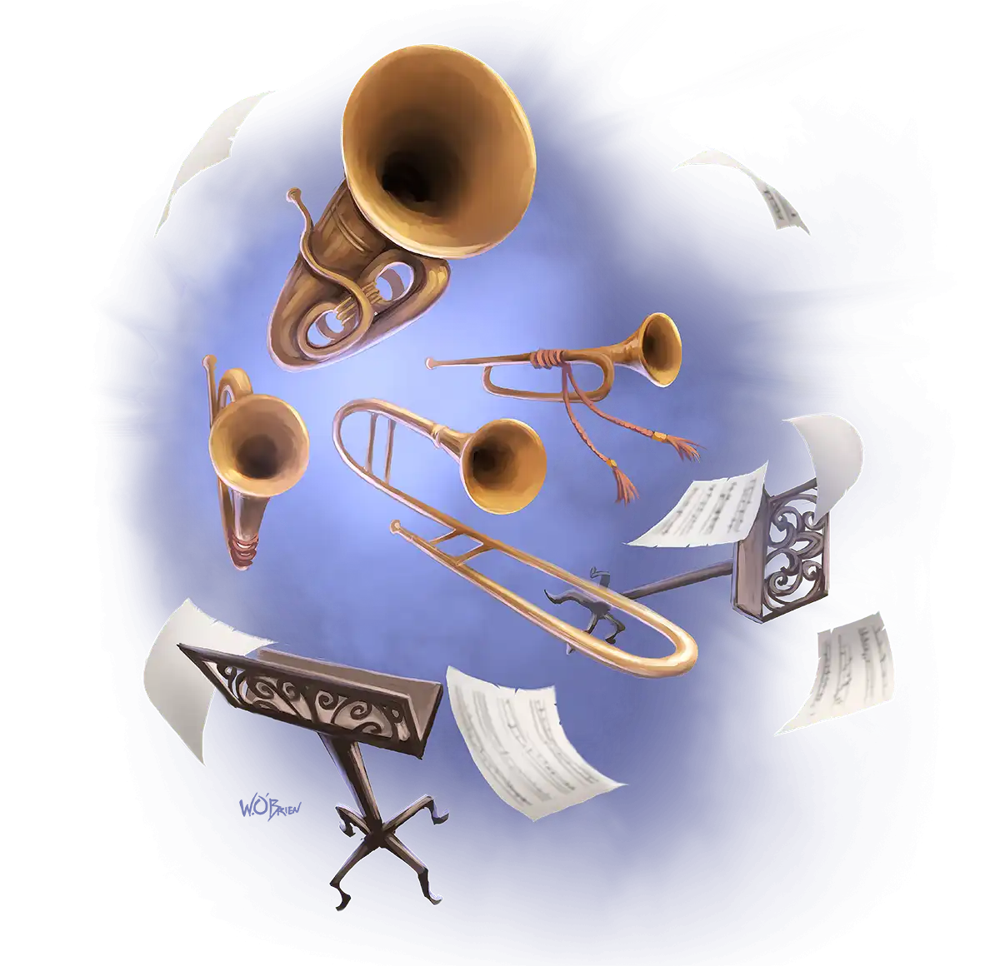
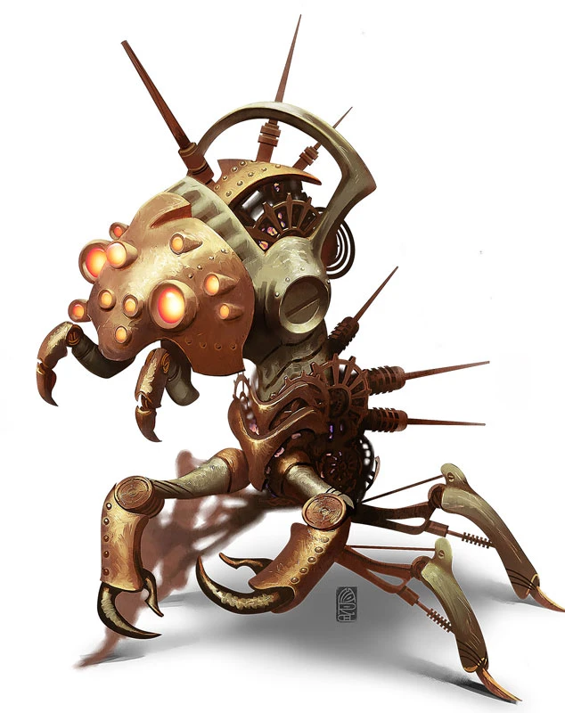
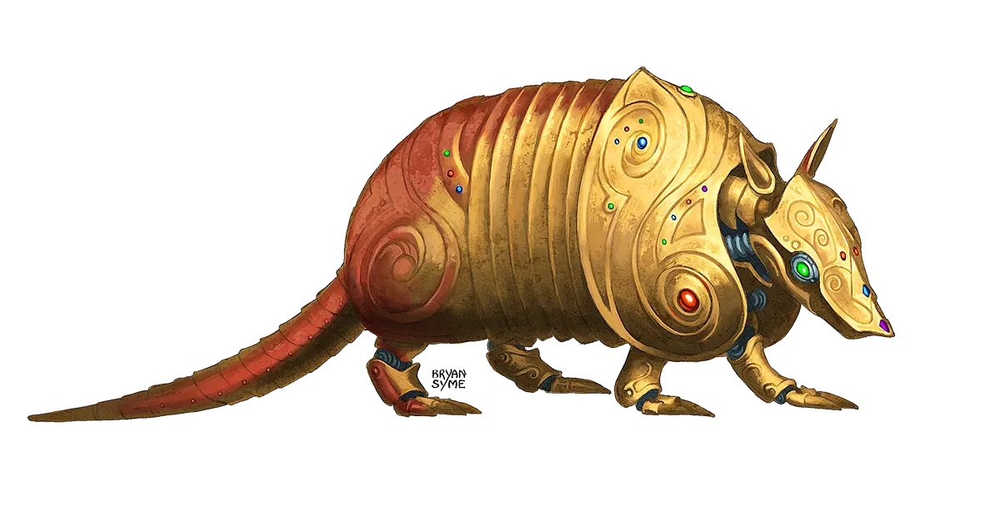
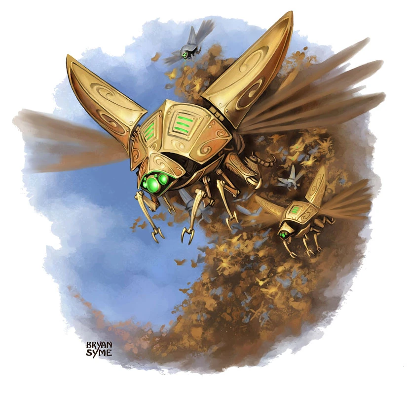
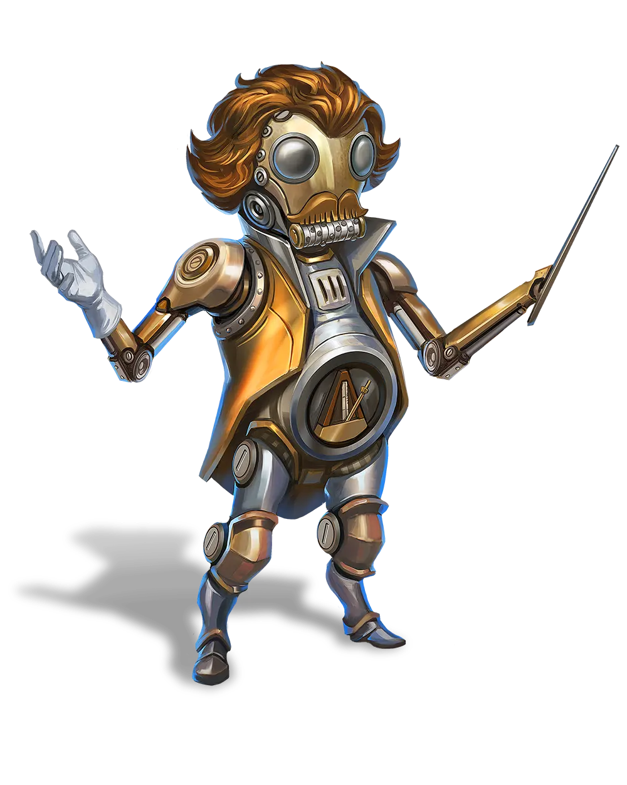
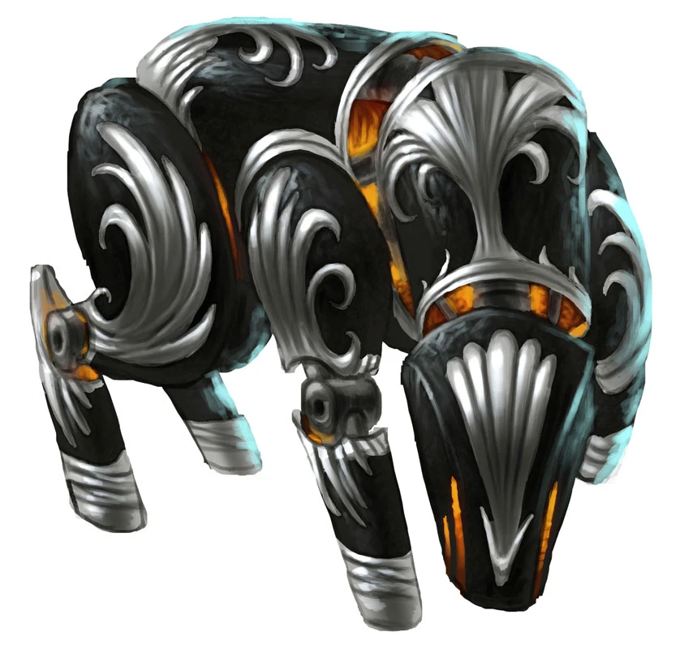

# Fichas de referência completas com imagens físicas — E

**Escopo:** lote E (195 criaturas). Este documento mostra apenas as fichas com regras transcritas e conferidas individualmente; as restantes não estão completas aqui.

**Importante:** as regras abaixo são referências de D&D 5e, ainda sem adaptação final para a economia de ações do jogo de cartas. Revisão independente pendente. Cada imagem apontada é um arquivo físico da própria branch.

---

## TF-059 — Animated Instrument, Animated Quartet

**Large Construct · Unaligned · ND 4 (1100 XP) · Proficiência +2**

**CA 14** (armadura natural) · **PV 102** (12d10+36) · **Deslocamento:** walk +30, fly +50, hover true pés

| FOR | DES | CON | INT | SAB | CAR |
|---:|---:|---:|---:|---:|---:|
| 10 (+0) | 16 (+3) | 17 (+3) | 4 (-3) | 5 (-3) | 18 (+4) |

**Salvaguardas:** — · **Perícias:** Performance +8

**Resistências:** — · **Imunidades a dano:** poison, psychic

**Imunidades a condições:** blinded, charmed, deafened, exhaustion, frightened, paralyzed, petrified, poisoned

**Sentidos:** blindsight 60 ft; cego além desse alcance · **Percepção passiva:** 7 · **Idiomas:** —

### Características

**Susceptibilidade à antimagia.** No interior de um campo antimagia, fica incapacitado. Se receber dissipar magia, deve passar num teste de resistência de Constituição contra a CD de magia do conjurador ou cai inconsciente por 1 minuto.

**Natureza de construto.** Dispensa ar, alimentos, líquidos e descanso por sono.

**Aparência inofensiva.** Enquanto está imóvel e no chão, parece um conjunto comum de instrumentos musicais.

**Harmonia de quatro partes.** Os quatro instrumentos agem como uma criatura. Sempre que um ataque causar ao menos 25 pontos de dano de uma só vez, um instrumento é desativado; cada ataque Trouble Clef ou Orchestra Hit passa a causar um dado de dano a menos.

### Ações

**Ataque múltiplo.** Primeiro realiza Musical Arrangement; depois efetua dois ataques, escolhendo Trouble Clef e/ou Orchestra Hit.

**Trouble Clef.** Ataque corpo a corpo +5; alcance 5 pés. Dano: 4d4+3 bludgeoning. Um alvo ao alcance sofre dano contundente se atingido.

**Orchestra Hit.** Ataque à distância +6; alcance 60 pés. Dano: 4d6+4 thunder. Uma criatura ao alcance recebe dano trovejante se atingida.

**Musical Arrangement — Dreadful Dirge.** Resistência WIS CD 14. Cada inimigo a até 30 pés testa Sabedoria; quem falha fica amedrontado até o final do próximo turno do quarteto.

**Musical Arrangement — Oppressive Overture.** Resistência STR CD 14. Cada inimigo a até 30 pés testa Força; falha deixa a criatura caída.

**Musical Arrangement — Seditious Sonata.** Resistência CHA CD 14. Cada inimigo a até 30 pés testa Carisma. Falha: fica enfeitiçado pelo quarteto por até 1 minuto e não realiza ataques, efeitos prejudiciais ou ajuda a aliados. Repete a resistência no fim de cada turno; tomar dano também encerra o efeito.

**Reações:** nenhuma descrita na ficha de referência. **Ações lendárias:** nenhuma descrita.

**Fonte mecânica:** https://kpogl.wikidot.com/monster:animated-quartet

**Imagem verificada:** [TF-059](../../assets/creature-images/TF-059.webp) · SHA-256 `f83213468715872df722ecabc0cd6ceaa62a7f0eb2d761e5ac79e6d44efd3360`

---

## TF-060 — Clockwork Abomination

**Large Construct · Lawful Evil · ND 5 (1800 XP) · Proficiência +3**

**CA 16** (armadura natural) · **PV 76** (8d10+32) · **Deslocamento:** walk +30, climb +30 pés

| FOR | DES | CON | INT | SAB | CAR |
|---:|---:|---:|---:|---:|---:|
| 21 (+5) | 12 (+1) | 18 (+4) | 10 (+0) | 10 (+0) | 12 (+1) |

**Salvaguardas:** DEX +4, CON +7 · **Perícias:** Athletics +8, Perception +3, Stealth +4

**Resistências:** acid, cold, fire, bludgeoning/piercing/slashing de ataques não mágicos · **Imunidades a dano:** poison

**Imunidades a condições:** charmed, exhaustion, frightened, paralyzed, petrified, poisoned

**Sentidos:** darkvision 60 ft · **Percepção passiva:** 13 · **Idiomas:** Common, Infernal

### Características

**Natureza de construto.** Não precisa de ar, comida, bebida ou sono.

**Fonte infernal explosiva.** Quando é destruído, cada criatura a até 10 pés deve passar numa resistência de Destreza CD 14 ou sofrer 4d6 de fogo (metade se passar). A explosão acende objetos inflamáveis que não estejam vestidos nem carregados.

**Forma imutável.** Não é afetado por efeitos que mudariam sua forma.

**Resistência à magia.** Tem vantagem em resistências contra magias e efeitos mágicos.

**Avanço implacável.** Terreno difícil não aumenta seus custos de deslocamento, e seu deslocamento não pode ser reduzido.

### Ações

**Ataque múltiplo.** Efetua um ataque Bite e outro Slam.

**Bite.** Ataque corpo a corpo +8; alcance 10 pés. Dano: 2d8+5 piercing + 2d6 fire. Uma criatura ao alcance sofre os dois componentes de dano se atingida.

**Slam.** Ataque corpo a corpo +8; alcance 15 pés. Dano: 2d6+5 bludgeoning. Golpe mecânico a até 15 pés.

**Fire Breath.** Dano: 6d6 fire. Recarga 5-6. Resistência DEX CD 14. Todas as criaturas no cone fazem a resistência; sofrem dano de fogo integral na falha ou metade no sucesso.

**Reações:** nenhuma descrita na ficha de referência. **Ações lendárias:** nenhuma descrita.

**Fonte mecânica:** https://kpogl.wikidot.com/monster:clockwork-abomination

**Imagem verificada:** [TF-060](../../assets/creature-images/TF-060.webp) · SHA-256 `1d5be21a605da8dbce1a8f86421b4cfe1a6db0006cdb69eb94c76792469af89c`

---

## TF-061 — Clockwork Armadillo

**Small Construct · Unaligned · ND 1/4 (50 XP) · Proficiência +2**

**CA 14** (armadura natural) · **PV 22** (4d6+8) · **Deslocamento:** walk +30 pés

| FOR | DES | CON | INT | SAB | CAR |
|---:|---:|---:|---:|---:|---:|
| 10 (+0) | 18 (+4) | 14 (+2) | 5 (-3) | 10 (+0) | 10 (+0) |

**Salvaguardas:** DEX +6 · **Perícias:** Acrobatics +6, Perception +2, Stealth +6

**Resistências:** — · **Imunidades a dano:** poison, psychic

**Imunidades a condições:** charmed, exhaustion, frightened, paralyzed, petrified, poisoned

**Sentidos:** darkvision 60 ft · **Percepção passiva:** 12 · **Idiomas:** compreende os idiomas do criador; não fala

### Características

**Natureza de construto.** Não necessita respirar, beber, comer ou dormir.

**Forma imutável.** Imune a efeitos que mudariam sua forma.

**Resistência à magia.** Vantagem em resistências contra magias ou outros efeitos mágicos.

**Engrenagens aceleradas.** Vantagem nas jogadas de iniciativa.

### Ações

**Scissor Claws.** Ataque corpo a corpo +6; alcance 5 pés. Dano: 1d4+4 slashing. Resistência CON CD 11. Ao acertar, além do dano cortante, o alvo realiza resistência de Constituição CD 11; se falhar, larga o objeto que estiver segurando.

**Tuck In.** Enrola-se numa esfera blindada e passa a rolar para mover-se. Enquanto enrolado, resiste a dano contundente, perfurante e cortante, fica imune à condição caída e não pode usar Scissor Claws. Como parte da ação, pode guardar sob o casco um objeto solto (não vestido ou carregado), de tamanho no máximo Small, a até 5 pés.

### Ações bônus

**Desenrolar.** Sai da forma de bola e libera qualquer objeto guardado, usando uma ação bônus.

**Reações:** nenhuma descrita na ficha de referência. **Ações lendárias:** nenhuma descrita.

**Fonte mecânica:** https://kpogl.wikidot.com/monster:clockwork-armadillo

**Imagem verificada:** [TF-061](../../assets/creature-images/TF-061.webp) · SHA-256 `294028acff7f7516abad8705bb33eb4ec934cfd59499baf214b276e303634edb`

---

## TF-063 — Clockwork Beetle Swarm

**Large swarm of Tiny Constructs · Unaligned · ND 3 (700 XP) · Proficiência +2**

**CA 14** (armadura natural) · **PV 52** (8d10+8) · **Deslocamento:** walk +30, fly +50 pés

| FOR | DES | CON | INT | SAB | CAR |
|---:|---:|---:|---:|---:|---:|
| 8 (-1) | 16 (+3) | 12 (+1) | 1 (-5) | 12 (+1) | 7 (-2) |

**Salvaguardas:** — · **Perícias:** —

**Resistências:** bludgeoning, piercing, slashing · **Imunidades a dano:** poison, psychic

**Imunidades a condições:** charmed, exhaustion, frightened, grappled, paralyzed, petrified, poisoned, prone, restrained, stunned

**Sentidos:** darkvision 60 ft · **Percepção passiva:** 11 · **Idiomas:** —

### Características

**Natureza de construto.** Dispensa ar, alimentos, bebida e sono.

**Resistência mágica.** Vantagem em salvaguardas contra magias e efeitos mágicos.

**Enxame.** Divide o espaço com outras criaturas e atravessa aberturas suficientes para um construto Tiny. Não pode recuperar pontos de vida nem ganhar pontos de vida temporários.

### Ações

**Bites.** Ataque corpo a corpo +5; alcance undefined pés. Dano: 4d8 piercing + 1d6 poison. Escolhe um alvo que esteja dentro do seu espaço; em um acerto, causa o dano perfurante e o veneno. Quando estiver com metade ou menos dos PV máximos, o dano perfurante diminui de 4d8 para 2d8.

**Reações:** nenhuma descrita na ficha de referência. **Ações lendárias:** nenhuma descrita.

**Fonte mecânica:** https://kpogl.wikidot.com/monster:clockwork-beetle-swarm

**Imagem verificada:** [TF-063](../../assets/creature-images/TF-063.webp) · SHA-256 `ff4fba0df30b151e80ac06cbca33d188777bae47ab07b76b07538183ea7dc72d`

---

## TF-064 — Clockwork Conductor

**Small Construct · Lawful Neutral · ND 1/2 (100 XP) · Proficiência +2**

**CA 13** (armadura natural) · **PV 28** (8d6) · **Deslocamento:** walk +30 pés

| FOR | DES | CON | INT | SAB | CAR |
|---:|---:|---:|---:|---:|---:|
| 7 (-2) | 12 (+1) | 10 (+0) | 9 (-1) | 12 (+1) | 16 (+3) |

**Salvaguardas:** — · **Perícias:** Perception +3, Performance +7

**Resistências:** — · **Imunidades a dano:** lightning, poison, psychic, thunder

**Imunidades a condições:** blinded, charmed, deafened, exhaustion, frightened, paralyzed, petrified, poisoned

**Sentidos:** darkvision 60 ft · **Percepção passiva:** 13 · **Idiomas:** entende os idiomas de seu criador; não fala

### Características

**Natureza de construto.** Não precisa de ar, comida, bebida nem sono.

**Forma imutável.** Imune à alteração mágica da própria forma.

**Resistência mágica.** Vantagem em salvaguardas contra magias ou outros efeitos mágicos.

**Metronomic Aura.** Uma criatura aliada a até 20 pés pode escolher tratar como 10 o resultado natural do d20 em uma jogada de ataque ou teste de Carisma (Atuação).

### Ações

**Conductive Baton.** Ataque corpo a corpo +3; alcance 5 pés. Dano: 1d4+1 bludgeoning + 1d8 lightning. Se o ataque acertar, causa ambos os danos e impede reações do alvo até o início do próximo turno dele.

**Overclocked Finale.** Recarga short_or_long_rest. Todos os aliados a até 30 pés que consigam ver o maestro ganham +5 em ataques, rolagens de dano e testes de habilidade até o fim do próximo turno do maestro. Depois role 1d6: 1–4 impede Concerted Effort até o próximo descanso curto; 5–6 impede Concerted Effort e desativa Metronomic Aura até o próximo descanso curto.

### Ações bônus

**Concerted Effort.** Escolhe a si mesmo ou aliado visível a até 30 pés. Até o começo do próximo turno do maestro, esse alvo soma 1d4 às suas jogadas de ataque e aos testes de resistência de Constituição para manter concentração.

**Reações:** nenhuma descrita na ficha de referência. **Ações lendárias:** nenhuma descrita.

**Fonte mecânica:** https://kpogl.wikidot.com/monster:clockwork-conductor

**Imagem verificada:** [TF-064](../../assets/creature-images/TF-064.webp) · SHA-256 `ae287ecf0a484b449e0e530abf9c4b11fe954035109ee8cc8bb4ce5ef6f87347`

---

## TF-065 — Clockwork Hound

**Medium Construct · Unaligned · ND 2 (450 XP) · Proficiência +2**

**CA 12** (sem armadura indicada) · **PV 71** (11d8+22) · **Deslocamento:** walk +50 pés

| FOR | DES | CON | INT | SAB | CAR |
|---:|---:|---:|---:|---:|---:|
| 16 (+3) | 15 (+2) | 14 (+2) | 1 (-5) | 10 (+0) | 1 (-5) |

**Salvaguardas:** DEX +4, CON +4 · **Perícias:** Athletics +7, Perception +4

**Resistências:** — · **Imunidades a dano:** poison, psychic

**Imunidades a condições:** charmed, exhaustion, frightened, paralyzed, petrified, poisoned

**Sentidos:** darkvision 60 ft · **Percepção passiva:** 14 · **Idiomas:** entende Common; não fala

### Características

**Natureza de construto.** Não depende de ar, alimento, bebida ou sono.

**Rastreador obstinado.** Vantagem em testes de Sabedoria (Percepção) e (Sobrevivência) que usem olfato ou sirvam para localizar uma criatura.

**Núcleo explosivo.** Quando destruído, obriga todas as criaturas a até 5 pés a fazer resistência de Destreza CD 12; falha sofre 2d6 de fogo, sucesso metade.

**Forma imutável.** Imune a efeitos que alterem sua forma.

**Resistência mágica.** Vantagem nas resistências contra magias e efeitos mágicos.

### Ações

**Bite.** Ataque corpo a corpo +5; alcance 5 pés. Dano: 2d10+3 piercing. Se atingir o alvo, causa dano perfurante.

**Tripping Tongue.** Ataque corpo a corpo +5; alcance 15 pés. Dano: 2d8+3 slashing. Resistência STR CD 13. Ao acertar com a língua laminada, o alvo sofre dano cortante e deve passar numa resistência de Força CD 13 ou fica caído.

**Reações:** nenhuma descrita na ficha de referência. **Ações lendárias:** nenhuma descrita.

**Fonte mecânica:** https://kpogl.wikidot.com/monster:clockwork-hound

**Imagem verificada:** [TF-065](../../assets/creature-images/TF-065.webp) · SHA-256 `beccb3e5441c44c21f773b777b7b44aab4df1147dc0969dc08fdf612af5070ac`
