# Referências de ilustração das 40 cartas — Aberração (15/10/2026)

## Atualização de estado — 23/11/2026

A branch agora contém **40/40 arquivos visuais**: 32 imagens de pesquisa anteriores e 8 artes originais candidatas. **Nenhuma das 40 está homologada para publicação ou integração.** O grid e os status pendentes abaixo são um snapshot de 15/10/2026; as pendências de arquivo das 8 criaturas foram supridas, mas a revisão visual continua aberta.

| Criatura | Arte original candidata | Fonte de identidade | Status |
|---|---|---|---|
| Malleable, Minor (TF-274) | 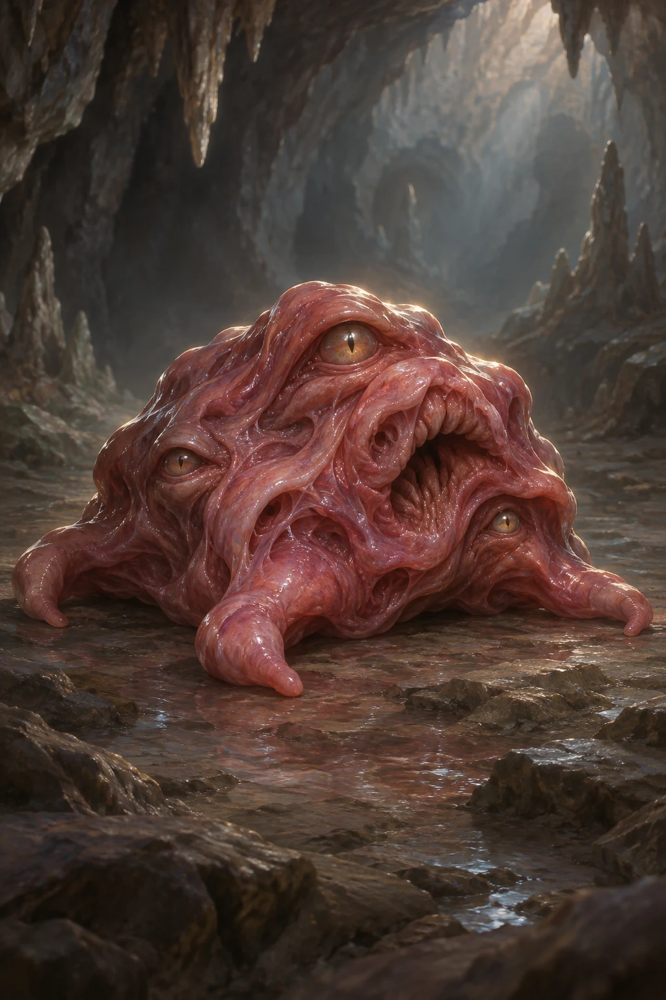 | [Ficha / identidade](https://www.5esrd.com/database/creature/malleable-minor/) | Original gerada; revisão humana pendente |
| Malleable, Moderate (TF-276) | 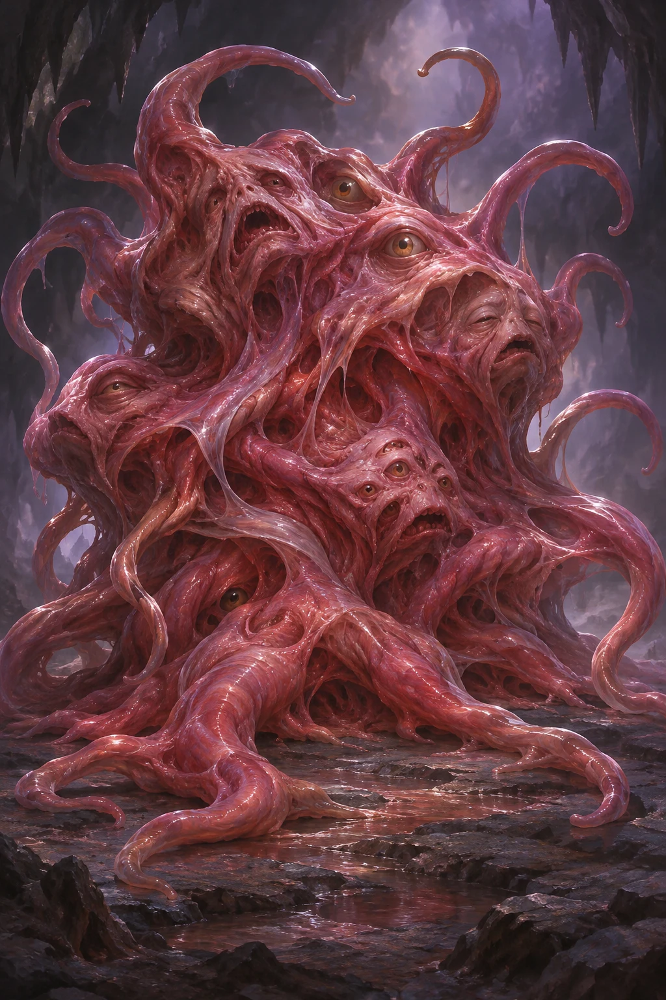 | [Ficha / identidade](https://www.5esrd.com/database/creature/malleable-moderate/) | Original gerada; revisão humana pendente |
| Malleable, Major (TF-284) | 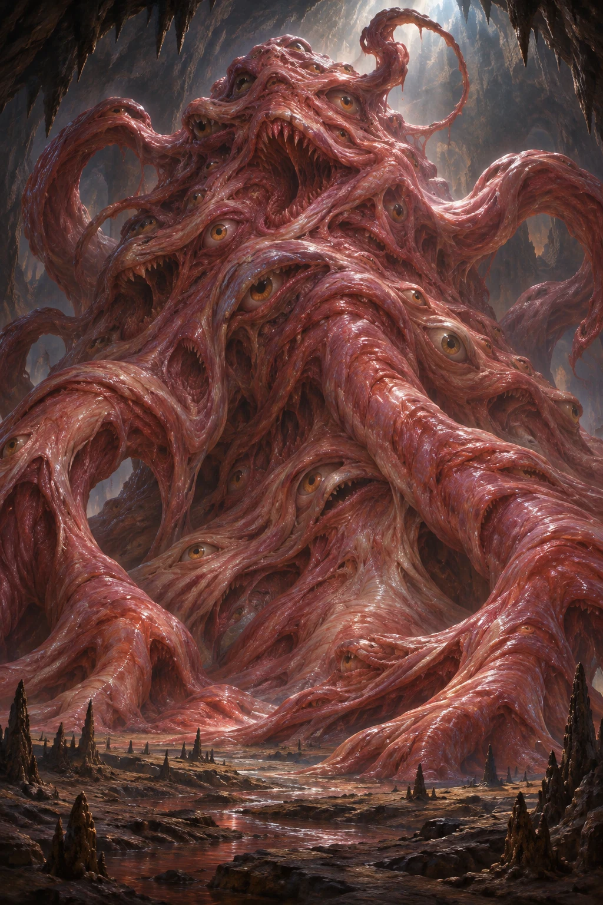 | [Ficha / identidade](https://www.5esrd.com/database/creature/malleable-major/) | Original gerada; revisão humana pendente |
| Malleable, Massive (TF-286) | 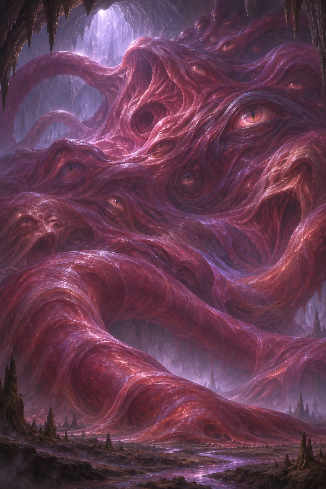 | [Ficha / identidade](https://koboldpress.com/tools/kobold-press-monsters/) | Original gerada; revisão humana pendente |
| Maw Swarm (TF-275) | 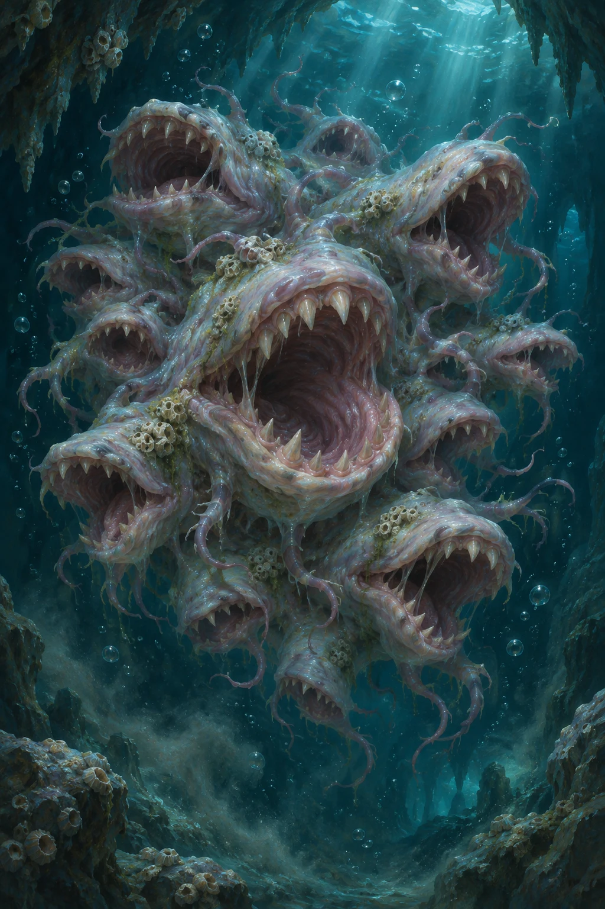 | [Ficha / identidade](https://a5e.tools/node/2840) | Original gerada; revisão humana pendente |
| Mayday (TF-520) | 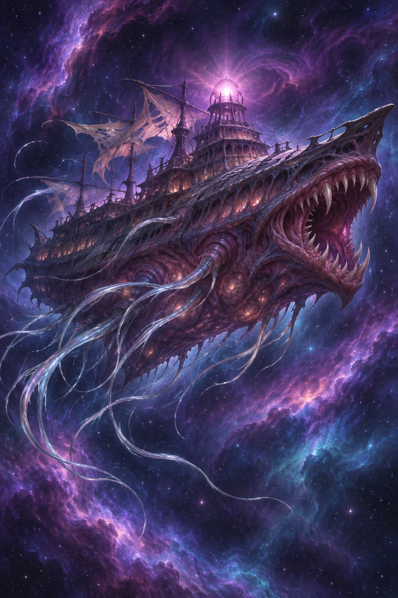 | [Ficha / identidade](https://a5e.tools/node/5326) | Original gerada; revisão humana pendente |
| Shukankor (TF-283) | 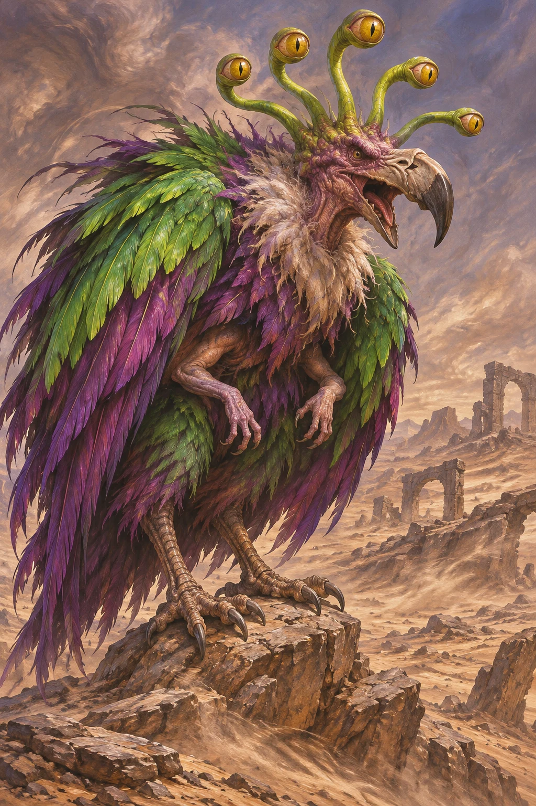 | [Ficha / identidade](https://www.robinloft.com/monsters/shukankor/tome-of-beasts-2) | Original gerada; revisão humana pendente |
| Aboleth Brute (TF-015) | 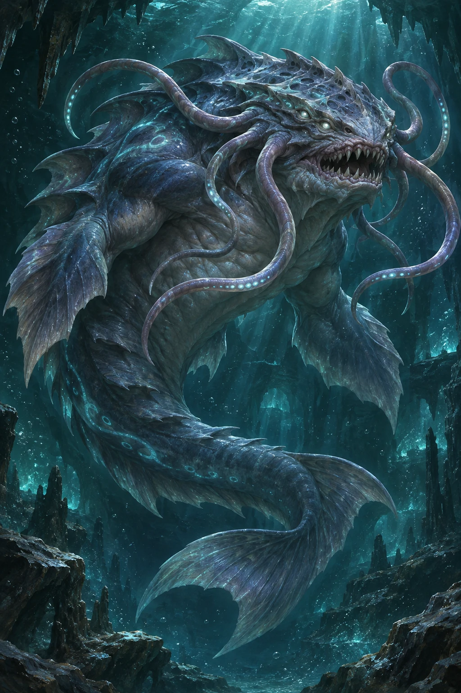 | [Ficha / identidade](https://a5e.tools/node/2819) | Original gerada; revisão humana pendente |

SHA-256 e proveniência estão em [IMAGENS_ORIGINAIS_CANDIDATAS_20261123.csv](IMAGENS_ORIGINAIS_CANDIDATAS_20261123.csv). As artes não copiam as ilustrações das fontes e não são imagens oficiais.

> **Pesquisa visual, não homologação.** Esta galeria utiliza arquivos de pesquisa já existentes no repositório e imagens em páginas originais confirmadas. Nenhuma imagem tem licença de publicação aprovada para o Card Game; não adicionar ao catálogo canônico automaticamente. Os tipos, ND e raridades permanecem os do `cards.csv`.

**Resultado histórico (15/10/2026):** 32 arquivos visuais locais; 2 links diretos A5E e 6 artes ainda não localizadas. O estado atual é 40/40 arquivos, conforme a atualização acima; isso não significa aprovação visual. O arquivo antigo `TF-285.png` (Snallygaster) possui somente 3,3 KB e requer validação visual de resolução/identidade. Várias artes de Bestiários D&D representam edições diferentes; conferir a fidelidade visual antes do uso.

## Galeria por raridade — snapshot anterior (15/10/2026; pendências de arquivo superadas)

### Comum

| Ilustração 1 | Ilustração 2 |
|---|---|
|  **#01 Ahu-Nixta, Drudge** · ND 0.5 · TF-002 **Arquivo no GitHub** | <a href="images-web-pesquisa/EX-Cranium-Rat.webp">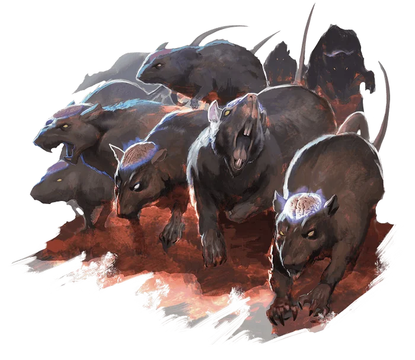</a> **#02 Cranium Rat** · ND 0 · externa **Arquivo no GitHub**
| <a href="images-web-pesquisa/EX-Gazer.webp">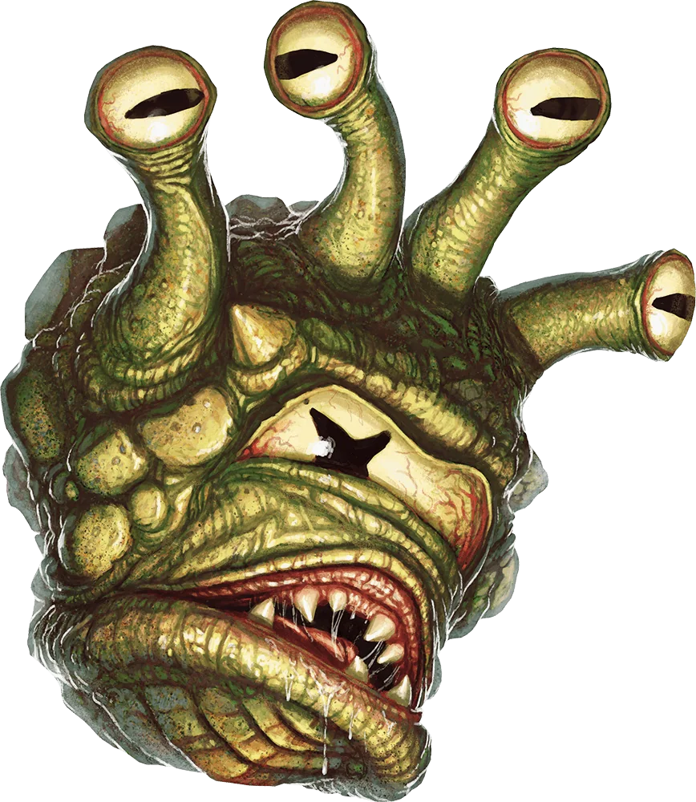</a> **#03 Gazer** · ND 1/2 · externa **Arquivo no GitHub** |  **#04 Light Eater** · ND 1/2 · TF-272 **Arquivo no GitHub**
|  **#05 Shoth, Sooze** · ND 1/2 · TF-273 **Arquivo no GitHub** | _Sem imagem confirmada_ **#06 Malleable, Minor** · ND 1 · TF-274 **PENDENTE — sem ilustração individual confiável** · [Consultar fonte](https://koboldpress.com/kpstore/product/tome-of-beasts-2-pawns/)
|  **#07 Birgemon Seal** · ND 2 · TF-005 **Arquivo no GitHub** | <a href="images-web-pesquisa/AT-001.webp">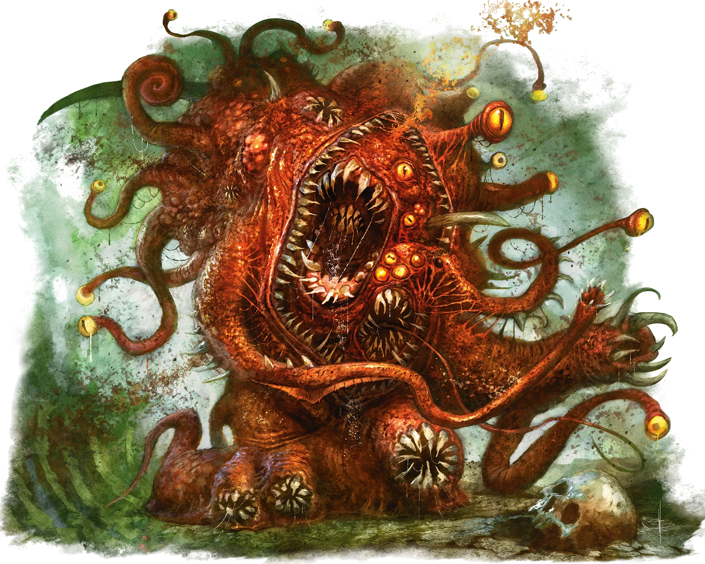</a> **#08 Gibbering Mouther** · ND 2 · AT-001 **Arquivo no GitHub**
|  **#09 Yann-An-Oed** · ND 2 · TF-007 **Arquivo no GitHub** |  **#10 Ahu-Nixta** · ND 3 · TF-001 **Arquivo no GitHub**
|  **#11 Astral Snapper** · ND 3 · TF-004 **Arquivo no GitHub** |  **#12 Xenabsorber** · ND 3 · TF-006 **Arquivo no GitHub**
| _Sem imagem confirmada_ **#13 Maw Swarm** · ND 4 · TF-275 **PENDENTE — sem ilustração individual confiável** · [Consultar fonte](https://a5e.tools/node/2840) |  **#14 Mayday** · ND 4 · TF-520 **Imagem web confirmada** · [Ficha A5E](https://a5e.tools/node/5326) · crédito: Ali Parlagi
|  **#15 Asanbosam** · ND 5 · TF-003 **Arquivo no GitHub** | _Sem imagem confirmada_ **#16 Malleable, Moderate** · ND 5 · TF-276 **PENDENTE — sem ilustração individual confiável** · [Consultar fonte](https://koboldpress.com/kpstore/product/tome-of-beasts-2-pawns/)
| <a href="images-web-pesquisa/AT-002.webp">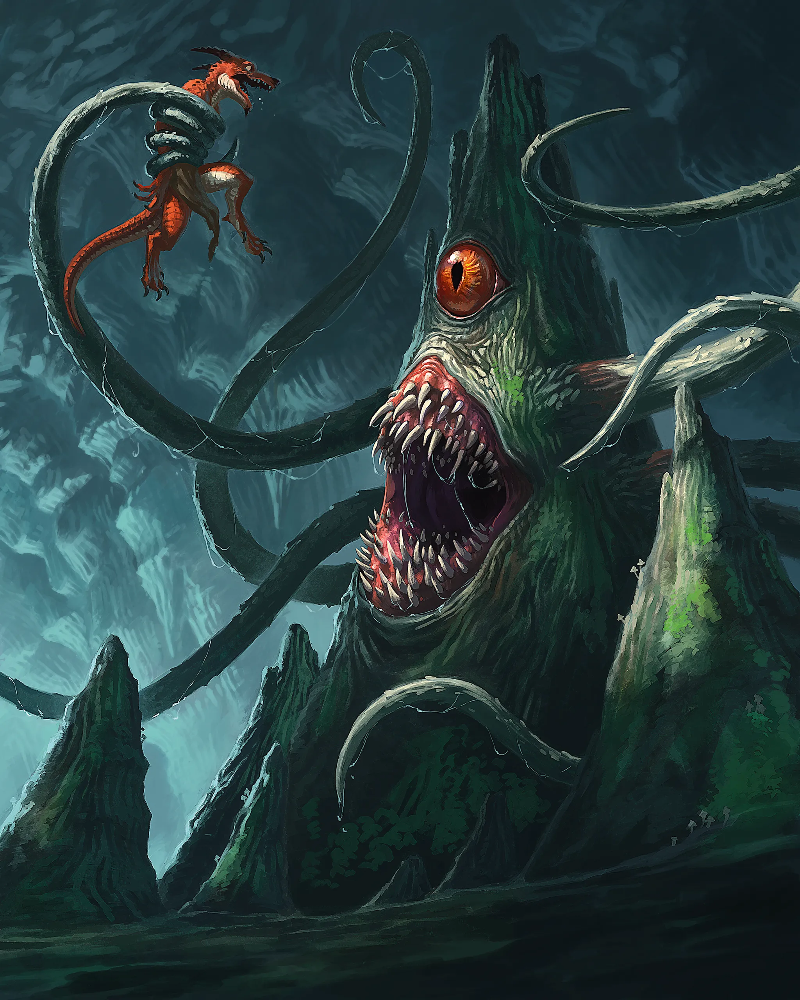</a> **#17 Roper** · ND 5 · AT-002 **Arquivo no GitHub** |  **#18 Shoth, Oth** · ND 5 · TF-277 **Arquivo no GitHub**
|  **#19 Snatch Bat** · ND 5 · TF-278 **Arquivo no GitHub** | <a href="images-web-pesquisa/EX-Mindwitness.webp">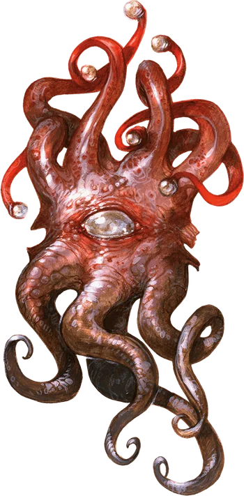</a> **#20 Mindwitness** · ND 5 · externa **Arquivo no GitHub**

### Incomum

| Ilustração 1 | Ilustração 2 |
|---|---|
|  **#21 Fate Eater** · ND 6 · TF-279 **Arquivo no GitHub** |  **#22 Mamura** · ND 6 · TF-280 **Arquivo no GitHub**
|  **#23 Yavalnoi** · ND 6 · TF-013 **Arquivo no GitHub** |  **#24 Chelicerae** · ND 7 · TF-010 **Arquivo no GitHub**
|  **#25 Crystalline Monolith** · ND 7 · KP-A001 **Arquivo no GitHub** |  **#26 Ahu-Nixta, Cataphract** · ND 8 · TF-008 **Arquivo no GitHub**
|  **#27 Astral Devourer** · ND 8 · TF-009 **Arquivo no GitHub** |  **#28 Ziphius** · ND 8 · TF-014 **Arquivo no GitHub**
| _Sem imagem confirmada_ **#29 Shukankor** · ND 9 · TF-283 **PENDENTE — sem ilustração individual confiável** · [Consultar fonte](https://www.robinloft.com/monsters/shukankor/tome-of-beasts-2) |  **#30 Xhkarsh** · ND 9 · TF-012 **Arquivo no GitHub**
|  **#31 Aboleth** · ND 10 · AT-003 **Arquivo no GitHub** | _Sem imagem confirmada_ **#32 Malleable, Major** · ND 10 · TF-284 **PENDENTE — sem ilustração individual confiável** · [Consultar fonte](https://www.5esrd.com/database/creature/malleable-major/)

### Rara

| Ilustração 1 | Ilustração 2 |
|---|---|
|  **#33 Ancient Aboleth** · ND 11 · TF-017 **Arquivo no GitHub** |  **#34 Voidling** · ND 11 · TF-018 **Arquivo no GitHub**
|  **#35 Aboleth Brute** · ND 13 · TF-015 **Imagem web confirmada** · [Ficha A5E](https://a5e.tools/node/2819) · crédito: Kim Van Deun |  **#36 Forest Emperor** · ND 15 · KP-S002 **Arquivo no GitHub**
|  **#37 Snallygaster** · ND 15 · TF-285 **Arquivo no GitHub** |

### Lendária

| Ilustração 1 | Ilustração 2 |
|---|---|
| _Sem imagem confirmada_ **#38 Malleable, Massive** · ND 16 · TF-286 **PENDENTE — sem ilustração individual confiável** · [Consultar fonte](https://koboldpress.com/tools/kobold-press-monsters/) | <a href="images-web-pesquisa/EX-Kalaraq-Quori.webp">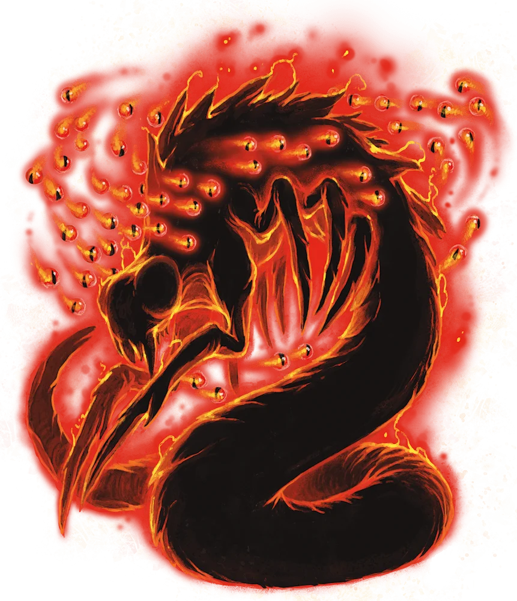</a> **#39 Kalaraq Quori** · ND 19 · externa **Arquivo no GitHub**

### Mítica

| Ilustração 1 | Ilustração 2 |
|---|---|
| <a href="images-web-pesquisa/EX-Greater-Star-Spawn-Emissary.webp">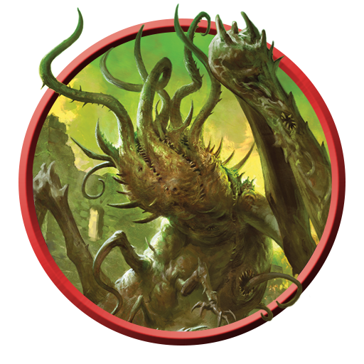</a> **#40 Greater Star Spawn Emissary** · ND 21 · externa **Arquivo no GitHub** |

## Seis pendências reais

- **Malleable, Minor (TF-274, ND 1), Moderate (TF-276, ND 5), Major (TF-284, ND 10) e Massive (TF-286, ND 16):** espécies/estágios identificados em *Tome of Beasts 2*. A [Kobold Press oferece pawns de Minor e Moderate](https://koboldpress.com/kpstore/product/tome-of-beasts-2-pawns/), mas não foi localizada imagem individual fiel verificável para cada um dos quatro estágios. Não reaproveitar imagens aleatórias de criaturas disformes.
- **Maw Swarm (TF-275, ND 4):** [ficha A5E](https://a5e.tools/node/2840), mas página não exibe arte da criatura para confirmar.
- **Shukankor (TF-283, ND 9):** [registro Robinloft](https://www.robinloft.com/monsters/shukankor/tome-of-beasts-2) cita Xan Drake, mas a imagem exposta é ícone genérico de Aberração, não uma ilustração da espécie. A imagem real ainda não foi confirmada.

### Regras de integridade

1. **32 arquivos no repositório** não equivalem a **32 licenças aprovadas**; inspecionar créditos, edição, espécie e resolução.
2. Para os dois links externos A5E, os arquivos de imagem ainda **não foram incorporados ao GitHub**; por isso `CAMINHO_IMAGEM_EXISTENTE` continua vazio no `cards.csv`.
3. Para os seis nomes pendentes, **não fabricar uma arte ou usar outra espécie como substituta**; prosseguir com ficha textual até encontrar uma imagem confiável.
4. Todas as imagens identificadas são **ilustrações de referência (web/repositório)**, sem alterar fichas, habilidades, tipos ou raridades.
