# Referências visuais — baralho de 40 Aberrações

## Atualização de estado — 23/11/2026

- Há **40/40 arquivos de imagem** na branch de pesquisa: os 32 arquivos anteriores e **8 ilustrações originais candidatas** geradas agora.
- As oito novas artes estão em `images-web-candidatas/`, em WebP 1024×1536. O manifesto com fonte de identidade, origem e SHA-256 é `IMAGENS_ORIGINAIS_CANDIDATAS_20261123.csv`.
- **0/40 imagens estão homologadas para o Card Game.** As novas artes são candidatas originais; precisam de revisão humana de identidade, qualidade e aceite antes de uso público.
- Também foi preparado `SUPORTES_PRECOMBATE_CANDIDATOS_20261123.md`: 40 efeitos homebrew candidatos, **0 homologados**, sem integração na mesa.
- Os números e pendências descritos abaixo refletem o estado histórico de 14–15/10/2026 e são superados por esta atualização.

### Oito ilustrações originais candidatas

| Criatura | Arte | Referência para identidade | Estado |
|---|---|---|---|
| Malleable, Minor (TF-274) | 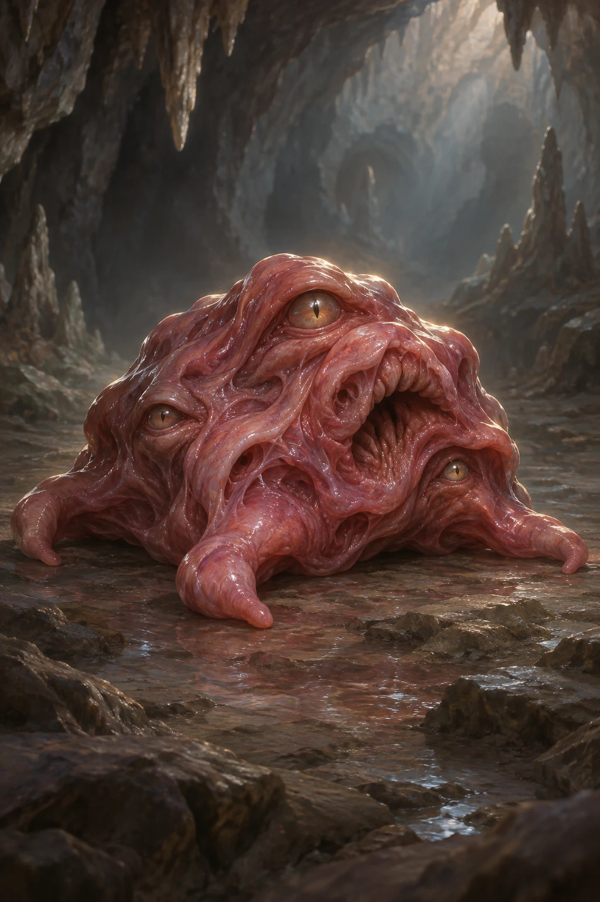 | [Ficha / identidade](https://www.5esrd.com/database/creature/malleable-minor/) | Original gerada; revisão humana pendente |
| Malleable, Moderate (TF-276) | 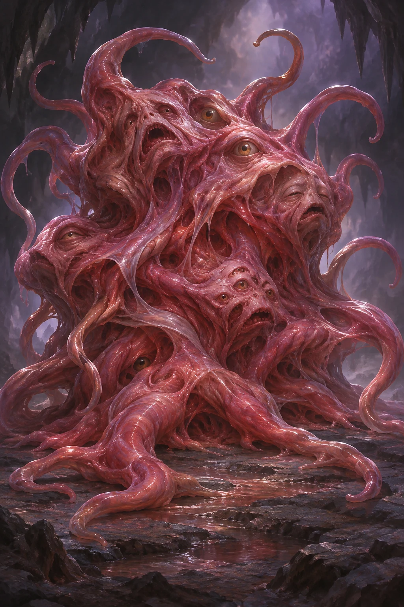 | [Ficha / identidade](https://www.5esrd.com/database/creature/malleable-moderate/) | Original gerada; revisão humana pendente |
| Malleable, Major (TF-284) | 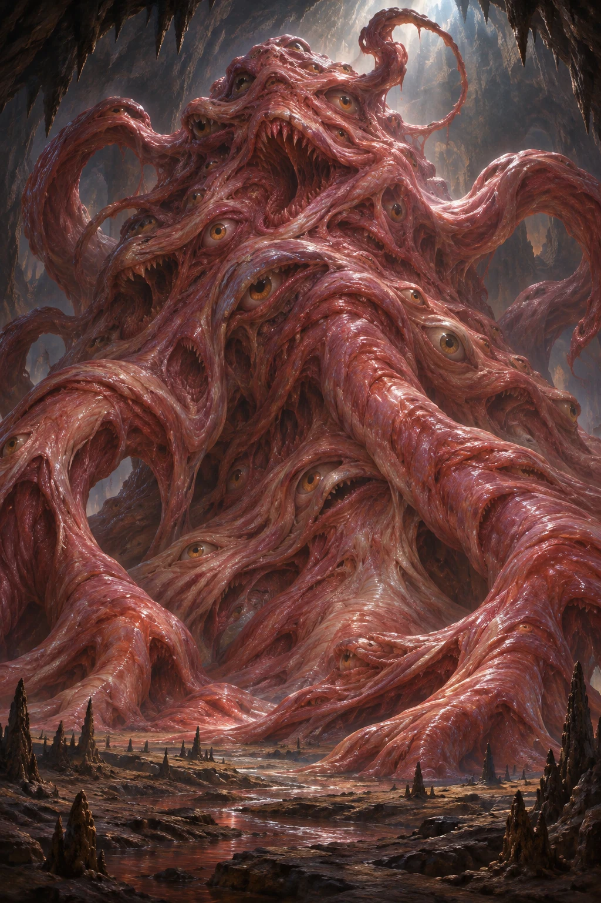 | [Ficha / identidade](https://www.5esrd.com/database/creature/malleable-major/) | Original gerada; revisão humana pendente |
| Malleable, Massive (TF-286) | 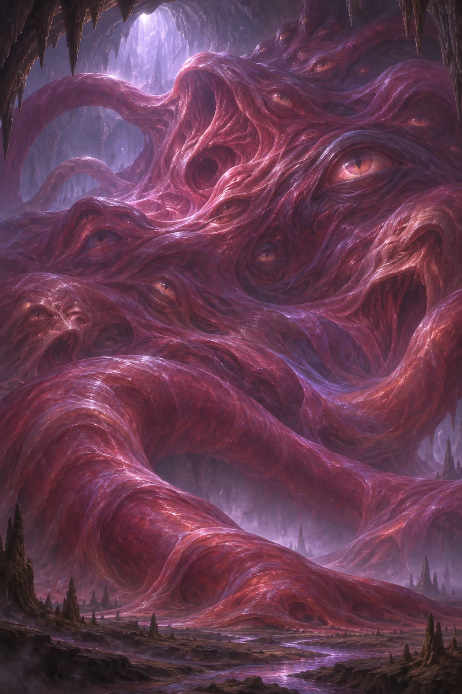 | [Ficha / identidade](https://koboldpress.com/tools/kobold-press-monsters/) | Original gerada; revisão humana pendente |
| Maw Swarm (TF-275) | 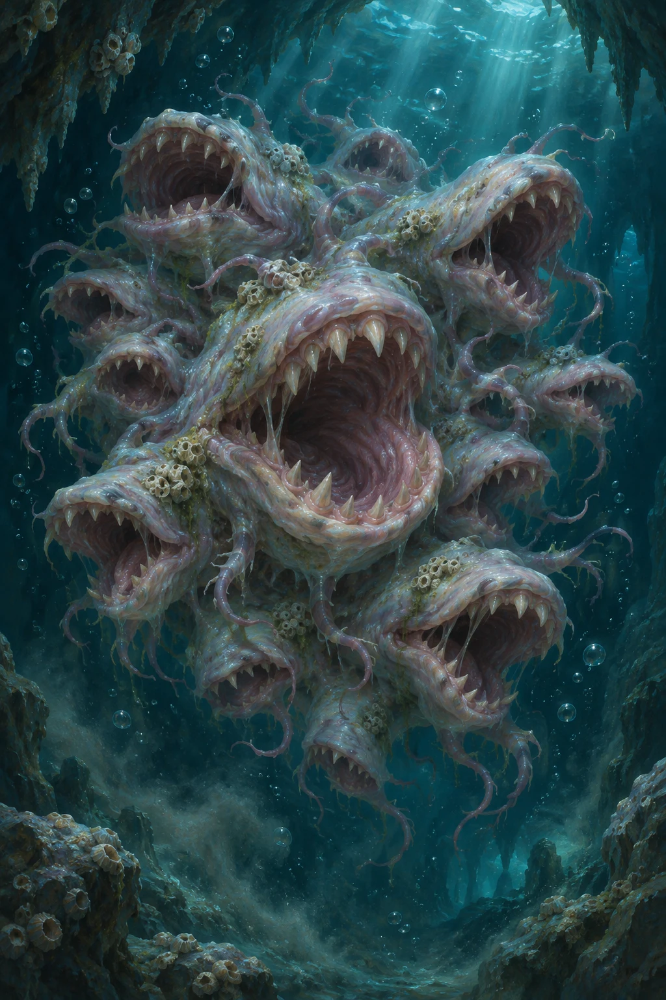 | [Ficha / identidade](https://a5e.tools/node/2840) | Original gerada; revisão humana pendente |
| Mayday (TF-520) | 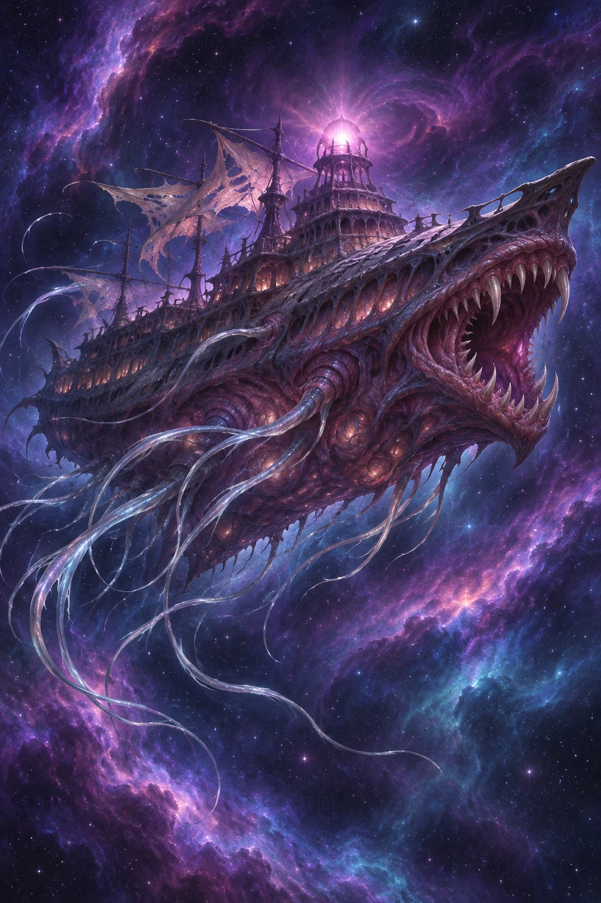 | [Ficha / identidade](https://a5e.tools/node/5326) | Original gerada; revisão humana pendente |
| Shukankor (TF-283) | 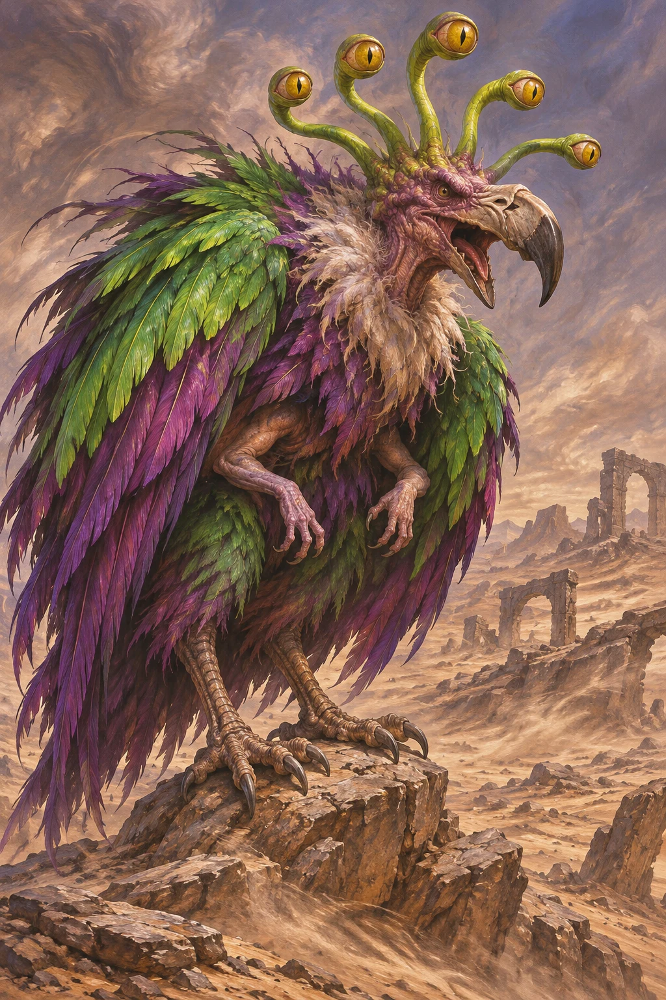 | [Ficha / identidade](https://www.robinloft.com/monsters/shukankor/tome-of-beasts-2) | Original gerada; revisão humana pendente |
| Aboleth Brute (TF-015) | 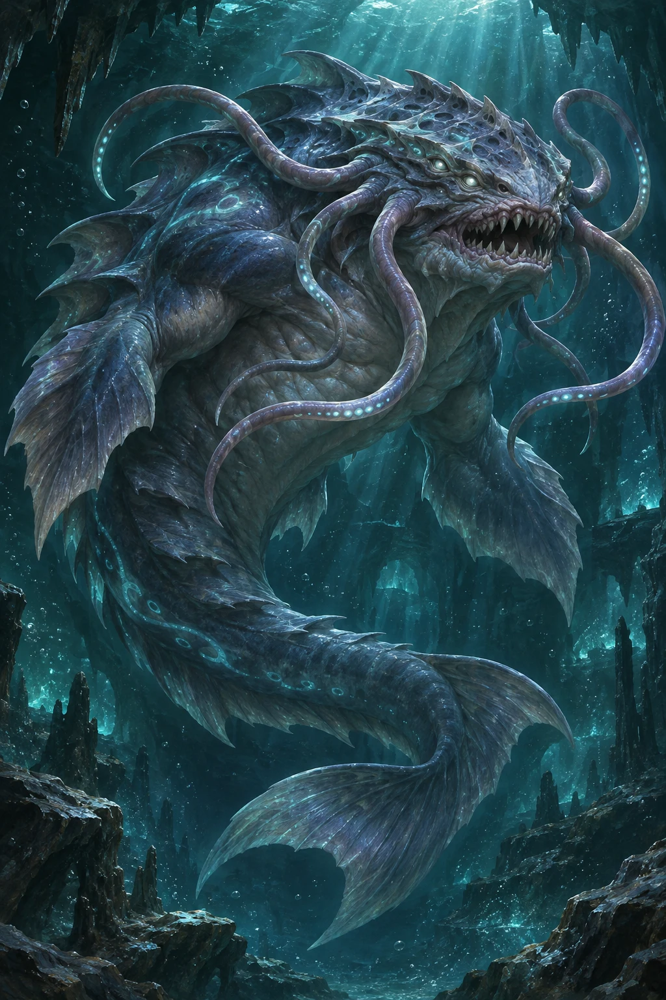 | [Ficha / identidade](https://a5e.tools/node/2819) | Original gerada; revisão humana pendente |

> Pesquisa de imagens para os testes. **Arquivos locais não significam arte oficial, licença aprovada ou ficha mecânica concluída.** Não integrar à produção automaticamente.

**Estado histórico de 15/10/2026:** 25/40 com arquivo pré-existente + 7 WebP = 32/40; a atualização de 23/11/2026 acima acrescenta as 8 artes originais candidatas e atualiza o total para 40/40. Os sete foram copiados diretamente de um acervo público de imagens da 5etools hospedado no GitHub, com a trilha da fonte no CSV.

## Sete imagens incorporadas à branch

| Criatura | Ilustração de referência (web) | Fonte |
|---|---|---|
| Cranium Rat | 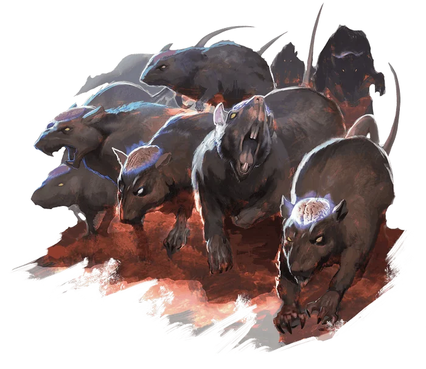 | [Bestiário VGM](https://github.com/5etools-mirror-3/5etools-img/blob/main/bestiary/VGM/Cranium%20Rat.webp); mesma criatura no deck MPMM, edição visual diferente |
| Gazer | 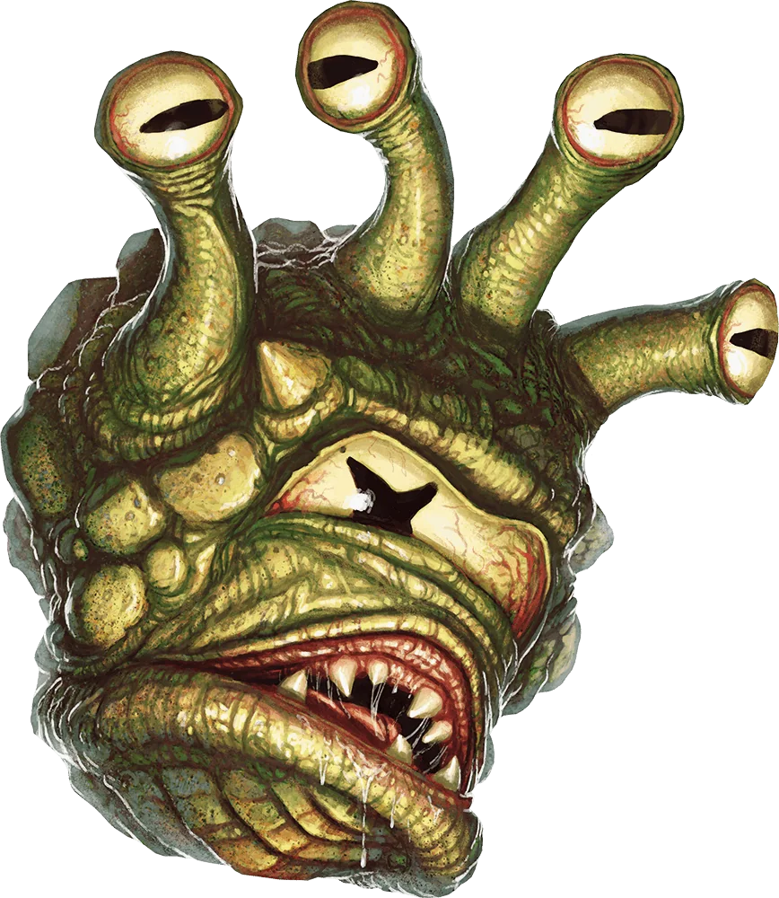 | [Bestiário MPMM](https://github.com/5etools-mirror-3/5etools-img/blob/main/bestiary/MPMM/Gazer.webp) |
| Mindwitness | 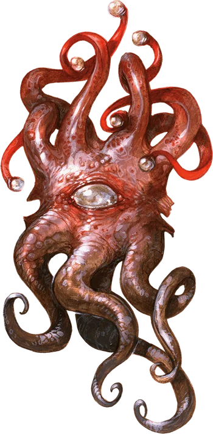 | [Bestiário MPMM](https://github.com/5etools-mirror-3/5etools-img/blob/main/bestiary/MPMM/Mindwitness.webp); ficha Volo no deck |
| Kalaraq Quori | 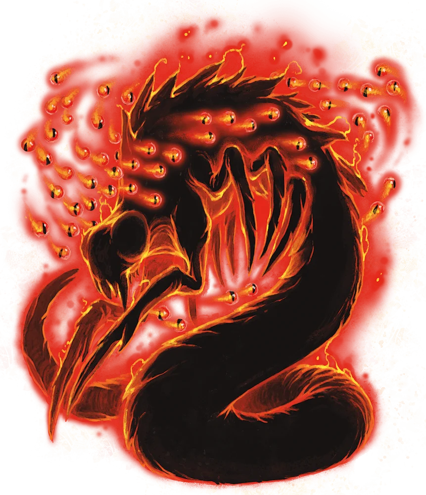 | [Bestiário ERLW](https://github.com/5etools-mirror-3/5etools-img/blob/main/bestiary/ERLW/Kalaraq%20Quori.webp) |
| Greater Star Spawn Emissary | 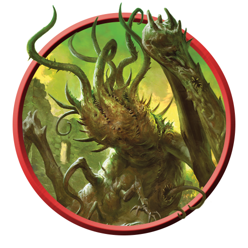 | [Token RHW](https://github.com/5etools-mirror-3/5etools-img/blob/main/bestiary/tokens/RHW/Greater%20Star%20Spawn%20Emissary.webp); edição distinta da VRGtR legacy |
| Gibbering Mouther | 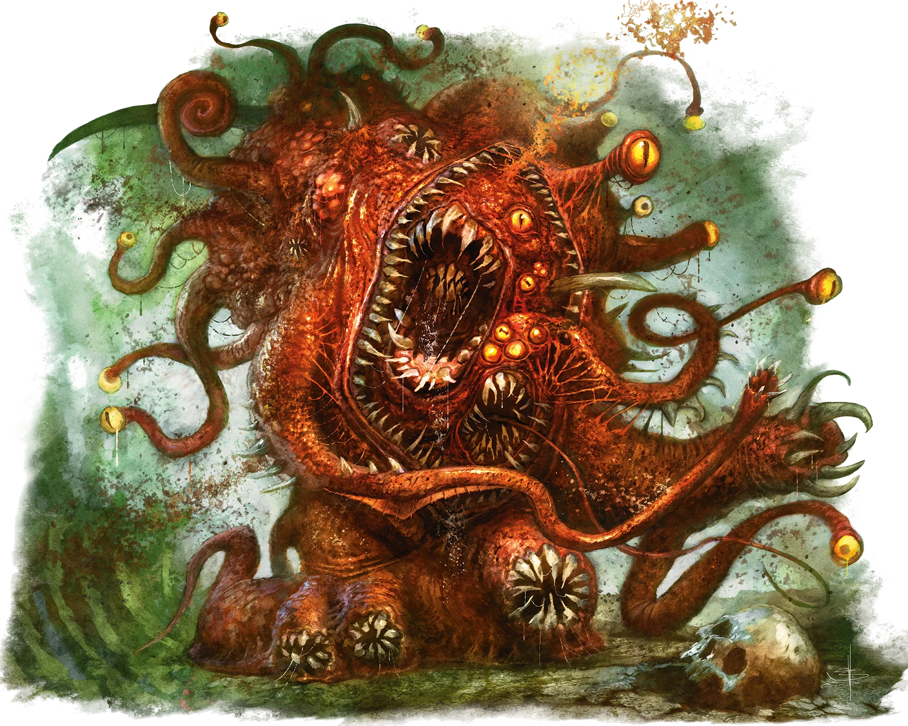 | [Bestiário XMM](https://github.com/5etools-mirror-3/5etools-img/blob/main/bestiary/XMM/Gibbering%20Mouther.webp) |
| Roper | 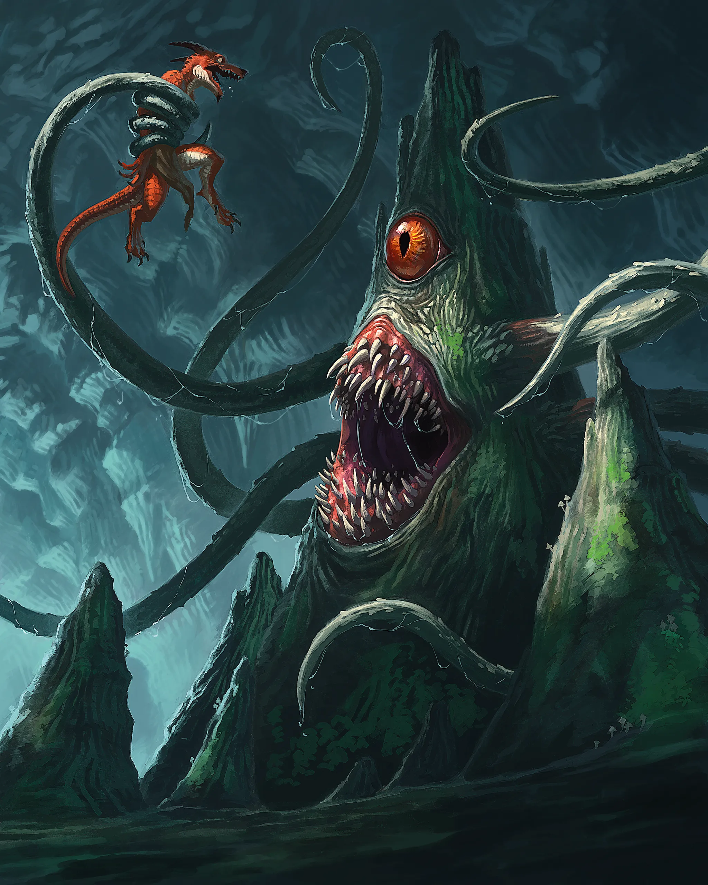 | [Bestiário XMM](https://github.com/5etools-mirror-3/5etools-img/blob/main/bestiary/XMM/Roper.webp) |

## Oito cartas que ainda não tinham imagem binária no snapshot de 15/10/2026

| Criatura | Fonte de pesquisa | Situação |
|---|---|---|
| Malleable, Minor | [Kobold Press — pawns](https://koboldpress.com/kpstore/product/tome-of-beasts-2-pawns/) | Só trilha por peça impressa e descrição; sem arte individual fiel isolada |
| Malleable, Moderate | [Kobold Press — pawns](https://koboldpress.com/kpstore/product/tome-of-beasts-2-pawns/) | Sem arquivo de imagem individual copiado |
| Malleable, Major | [5eSRD](https://www.5esrd.com/database/creature/malleable-major/) | Página da ficha; ainda sem imagem individual |
| Malleable, Massive | [Catálogo oficial Kobold Press](https://koboldpress.com/tools/kobold-press-monsters/) | Identidade conhecida; imagem individual pendente |
| Maw Swarm | [A5E](https://a5e.tools/node/2840) | Página e prévia de publicação; sem ilustração individual confirmada |
| Mayday | [Imagem direta A5E](https://a5e.tools/sites/default/files/monsters/AliParlagi_Mayday.png) | Link direto disponível, imagem binária ainda não copiada |
| Shukankor | [Robinloft](https://www.robinloft.com/monsters/shukankor/tome-of-beasts-2) | Página identifica criatura e credita ilustração a Xan Drake, cópia pendente |
| Aboleth Brute | [Imagem direta A5E](https://a5e.tools/sites/default/files/monsters/Aboleth%20-%20Kim%20Van%20Deun%20copy.jpg) | Link direto da página do Aboleth Brute; imagem binária não copiada |

Consulte `imagens-pesquisadas-15.csv` para o manifesto completo, com ID oficial quando existente, chave de pesquisa das externas, formato, origem e estado. As edições das imagens não mudam o ND e a ficha do catálogo; comparar a identidade do monstro antes de usar.

## Integração técnica

- O `cards.csv` deste pacote já aponta para os **sete caminhos WebP efetivamente gravados** e preserva o status `IMAGEM_DE_PESQUISA_LOCAL_NAO_HOMOLOGADA`.
- Os demais oito nomes aparecem no manifesto com `SEM_ARQUIVO_LOCAL_REFERENCIA_WEB`. Não preencher `CAMINHO_IMAGEM_EXISTENTE` com URLs de páginas, links não baixados ou espécies semelhantes.
- O catálogo oficial e o estado das partidas permanecem inalterados; pesquisas e arquivos estão somente na branch do PR.
