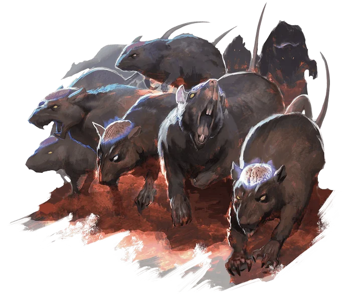
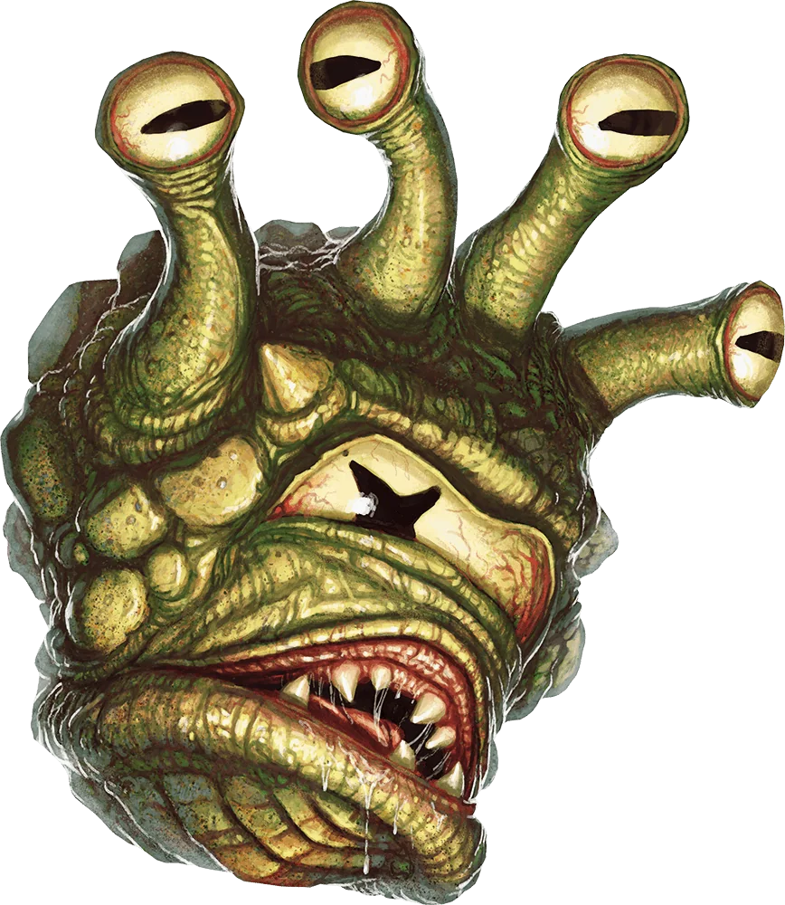
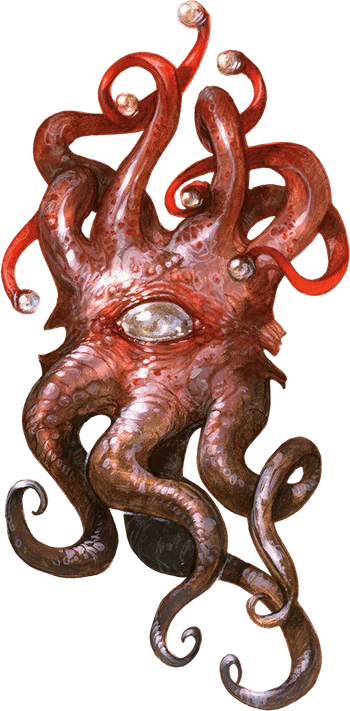
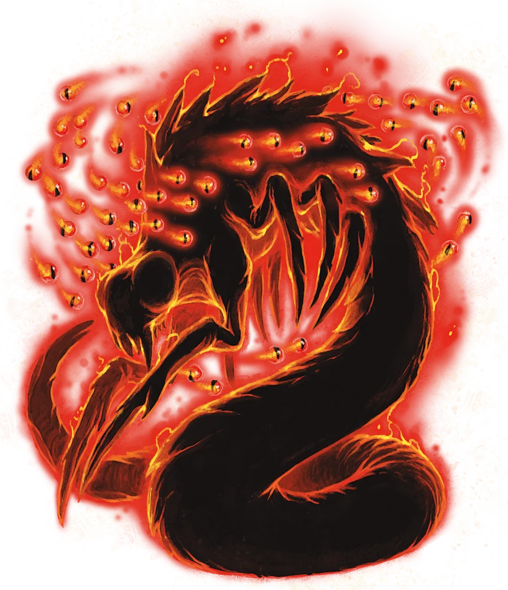
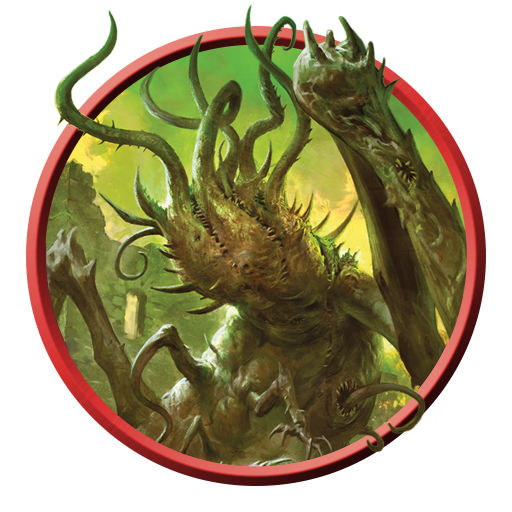
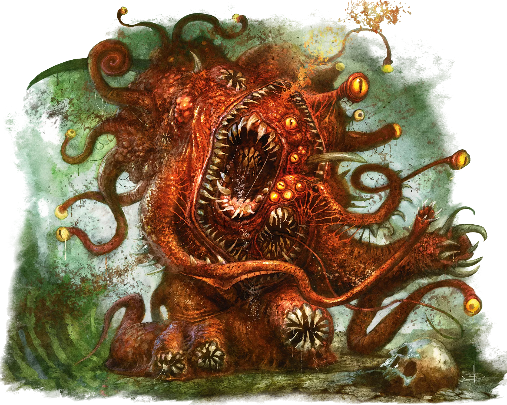
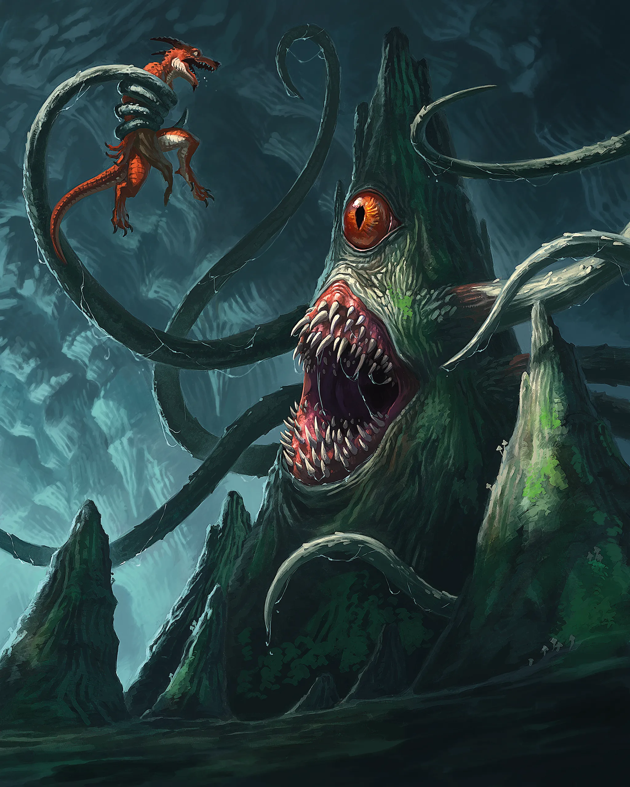

# Referências visuais — 15 pendências do baralho de Aberrações

> Pesquisa de imagens para os testes. **Arquivos locais não significam arte oficial, licença aprovada ou ficha mecânica concluída.** Não integrar à produção automaticamente.

**Estado atualizado:** 25/40 com arquivo pré-existente no repositório + **7 arquivos WebP adicionados nesta pesquisa** = **32/40 com imagem local**. Faltam **8 arquivos**. Os sete foram copiados diretamente de um acervo público de imagens da 5etools hospedado no GitHub, com a trilha da fonte no CSV.

## Sete imagens incorporadas à branch

| Criatura | Ilustração de referência (web) | Fonte |
|---|---|---|
| Cranium Rat |  | [Bestiário VGM](https://github.com/5etools-mirror-3/5etools-img/blob/main/bestiary/VGM/Cranium%20Rat.webp); mesma criatura no deck MPMM, edição visual diferente |
| Gazer |  | [Bestiário MPMM](https://github.com/5etools-mirror-3/5etools-img/blob/main/bestiary/MPMM/Gazer.webp) |
| Mindwitness |  | [Bestiário MPMM](https://github.com/5etools-mirror-3/5etools-img/blob/main/bestiary/MPMM/Mindwitness.webp); ficha Volo no deck |
| Kalaraq Quori |  | [Bestiário ERLW](https://github.com/5etools-mirror-3/5etools-img/blob/main/bestiary/ERLW/Kalaraq%20Quori.webp) |
| Greater Star Spawn Emissary |  | [Token RHW](https://github.com/5etools-mirror-3/5etools-img/blob/main/bestiary/tokens/RHW/Greater%20Star%20Spawn%20Emissary.webp); edição distinta da VRGtR legacy |
| Gibbering Mouther |  | [Bestiário XMM](https://github.com/5etools-mirror-3/5etools-img/blob/main/bestiary/XMM/Gibbering%20Mouther.webp) |
| Roper |  | [Bestiário XMM](https://github.com/5etools-mirror-3/5etools-img/blob/main/bestiary/XMM/Roper.webp) |

## Oito cartas com links pesquisados, mas sem bytes de imagem no Git

| Criatura | Fonte de pesquisa | Situação |
|---|---|---|
| Malleable, Minor | [Kobold Press — pawns](https://koboldpress.com/kpstore/product/tome-of-beasts-2-pawns/) | Só trilha por peça impressa e descrição; sem arte individual fiel isolada |
| Malleable, Moderate | [Kobold Press — pawns](https://koboldpress.com/kpstore/product/tome-of-beasts-2-pawns/) | Sem arquivo de imagem individual copiado |
| Malleable, Major | [5eSRD](https://www.5esrd.com/database/creature/malleable-major/) | Página da ficha; ainda sem imagem individual |
| Malleable, Massive | [Catálogo oficial Kobold Press](https://koboldpress.com/tools/kobold-press-monsters/) | Identidade conhecida; imagem individual pendente |
| Maw Swarm | [A5E](https://a5e.tools/node/2840) | Página e prévia de publicação; sem ilustração individual confirmada |
| Mayday | [Imagem direta A5E](https://a5e.tools/sites/default/files/monsters/AliParlagi_Mayday.png) | Link direto disponível, imagem binária ainda não copiada |
| Shukankor | [Robinloft](https://www.robinloft.com/monsters/shukankor/tome-of-beasts-2) | Página identifica criatura e credita ilustração a Xan Drake, cópia pendente |
| Aboleth Brute | [Imagem direta A5E](https://a5e.tools/sites/default/files/monsters/Aboleth%20-%20Kim%20Van%20Deun%20copy.jpg) | Link direto da página do Aboleth Brute; imagem binária não copiada |

Consulte `imagens-pesquisadas-15.csv` para o manifesto completo, com ID oficial quando existente, chave de pesquisa das externas, formato, origem e estado. As edições das imagens não mudam o ND e a ficha do catálogo; comparar a identidade do monstro antes de usar.

## Integração técnica

- O `cards.csv` deste pacote já aponta para os **sete caminhos WebP efetivamente gravados** e preserva o status `IMAGEM_DE_PESQUISA_LOCAL_NAO_HOMOLOGADA`.
- Os demais oito nomes aparecem no manifesto com `SEM_ARQUIVO_LOCAL_REFERENCIA_WEB`. Não preencher `CAMINHO_IMAGEM_EXISTENTE` com URLs de páginas, links não baixados ou espécies semelhantes.
- O catálogo oficial e o estado das partidas permanecem inalterados; pesquisas e arquivos estão somente na branch do PR.
