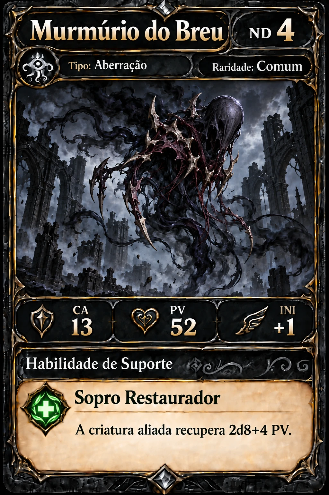
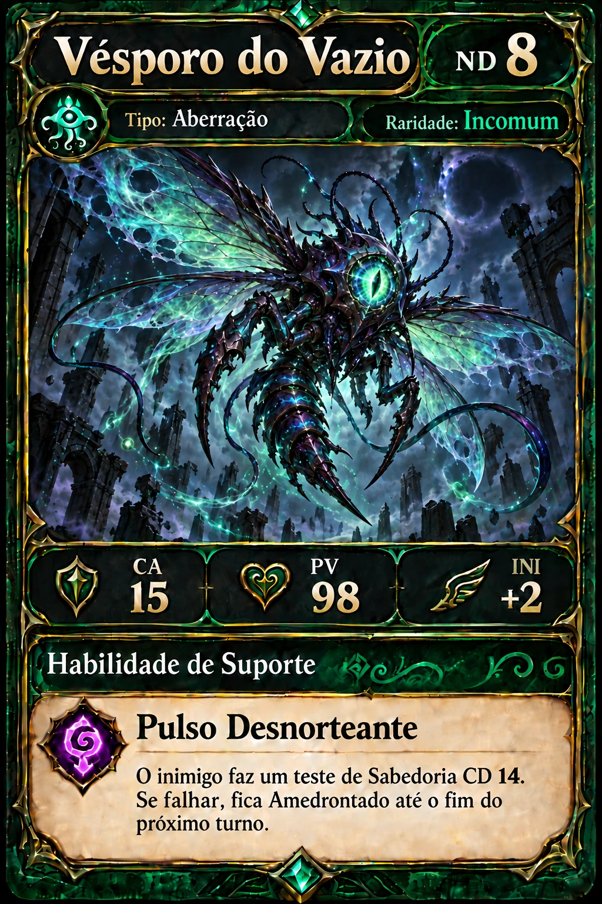
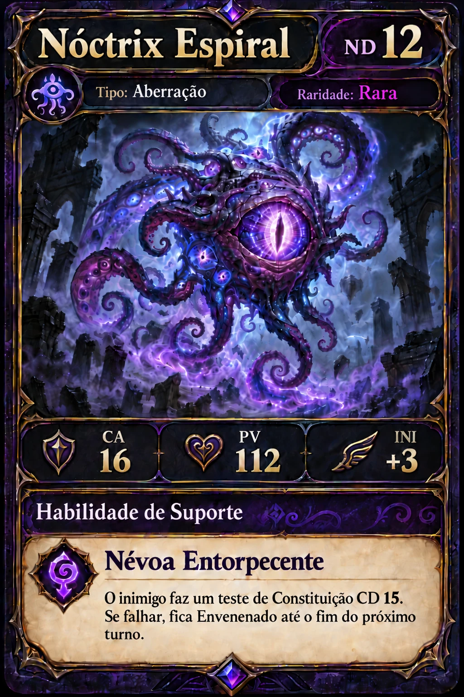
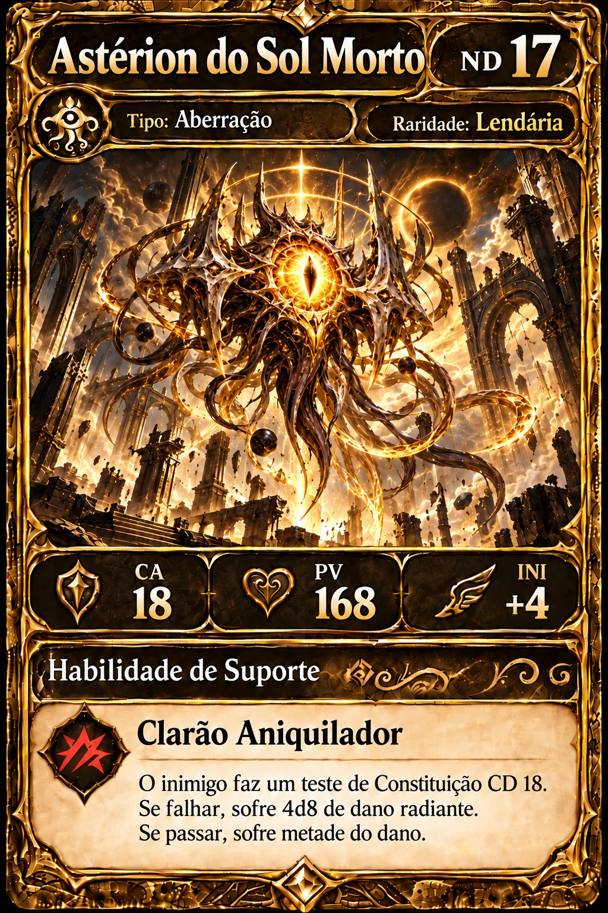
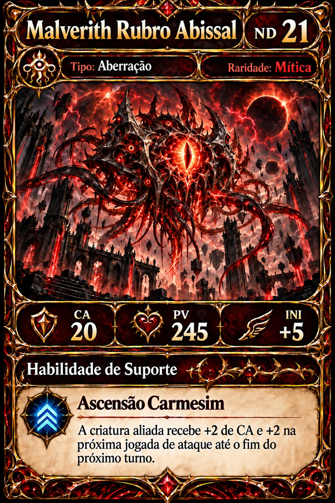
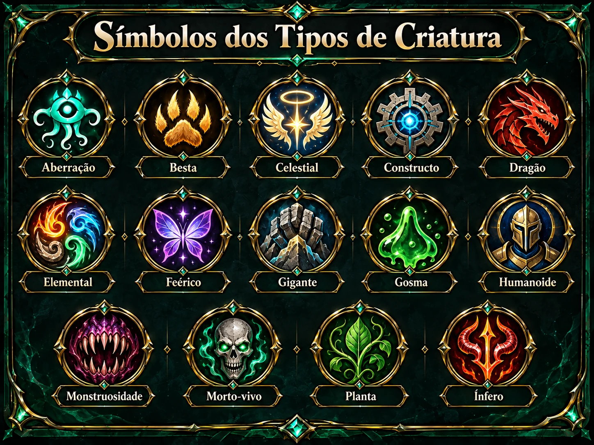
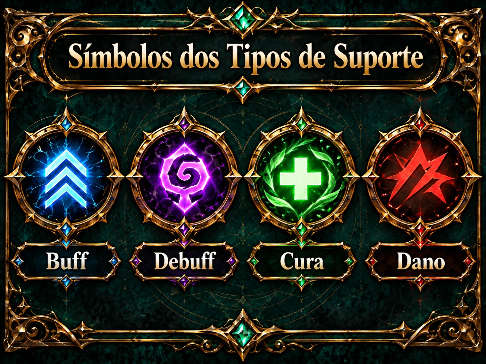

# SRD Card Game — Modelos visuais de cartas e símbolos (15/10/2026)

> **Identidade visual em revisão.** Este material registra as escolhas visuais feitas na conversa: cinco cartas ilustrativas **fictícias**, uma prancha com **14 tipos de criatura**, e uma prancha com **4 tipos de suporte**. As imagens foram geradas para exploração artística, **não são fichas oficiais nem criaturas do catálogo**. **0 novas cartas, habilidades ou artes homologadas.**

## 1. Estrutura do modelo de carta

- Cabeçalho: **Nome** e **ND** em posições fixas.
- Faixa secundária: **símbolo do tipo da criatura + nome do tipo**; **raridade escrita por extenso**, na paleta correspondente, **sem cristal ao lado de Raridade**.
- Área central dominante: ilustração da criatura, separada conceitualmente da ficha mecânica.
- Estatísticas em uma só faixa: **CA, PV, INI**; ícones minimalistas e integrados ao visual da moldura (escudo, coração, pena).
- Rodapé: cabeçalho contínuo **Habilidade de Suporte**, sem campo vazio à direita; abaixo, **apenas um símbolo de suporte**, nome da habilidade e texto legível em painel de pergaminho.
- A ficha estática é **ilustração de exemplo**. Na interface de partida, dados de PV atuais/máximos, ID único da cópia, condições e recursos ficam sob controle do árbitro.
- A cor da **raridade** é independente da cor do **tipo de suporte** e do símbolo do **tipo de criatura**.

## 2. Paleta de raridades — ND exclusivamente

| Raridade | ND | Moldura / detalhe | Exemplo fictício |
|---|---|---|---|
| **Comum** | 0–5 | Grafite/preto | [Murmúrio do Breu](assets/01_comum_murmurio_do_breu.webp) |
| **Incomum** | 6–10 | Verde | [Vésporo do Vazio](assets/02_incomum_vesporo_do_vazio.webp) |
| **Rara** | 11–15 | Roxo | [Nóctrix Espiral](assets/03_rara_noctrix_espiral.webp) |
| **Lendária** | 16–20 | Dourado | [Astérion do Sol Morto](assets/04_lendaria_asterion_sol_morto.webp) |
| **Mítica** | 21+ | Vermelho-escuro | [Malverith Rubro Abissal](assets/05_mitica_malverith_rubro_abissal.webp) |

### 2.1. As cinco versões finais

#### Comum — Murmúrio do Breu (ND 4)

CA 13 · PV 52 · INI +1 · Tipo Aberração · **Suporte Cura** — **Sopro Restaurador**. A criatura aliada recupera 2d8+4 PV.

#### Incomum — Vésporo do Vazio (ND 8)

CA 15 · PV 98 · INI +2 · Tipo Aberração · **Suporte Debuff** — **Pulso Desnorteante**. Sabedoria CD 14; em falha, Amedrontado até o fim do próximo turno.

#### Rara — Nóctrix Espiral (ND 12)

CA 16 · PV 112 · INI +3 · Tipo Aberração · **Suporte Debuff** — **Névoa Entorpecente**. Constituição CD 15; em falha, Envenenado até o fim do próximo turno.

#### Lendária — Astérion do Sol Morto (ND 17)

CA 18 · PV 168 · INI +4 · Tipo Aberração · **Suporte Dano** — **Clarão Aniquilador**. Constituição CD 18; 4d8 radiante na falha, metade no sucesso.

#### Mítica — Malverith Rubro Abissal (ND 21)

CA 20 · PV 245 · INI +5 · Tipo Aberração · **Suporte Buff** — **Ascensão Carmesim**. Criatura ativa aliada recebe +2 CA e +2 na próxima jogada de ataque até o fim do próximo turno.

**Nota:** os efeitos fictícios ilustrados acima são apenas texto de exemplo; não se aplicam às 40 habilidades candidatas reais, que requerem ficha original e homologação específica.

## 3. Os 14 tipos de criatura

| Tipo | Símbolo / motivo ilustrativo |
|---|---|
| Aberração | olho tentacular |
| Besta | pata |
| Celestial | asas, halo e luz |
| Constructo | engrenagem/núcleo |
| Dragão | cabeça dracônica |
| Elemental | quatro elementos |
| Feérico | asas de fada |
| Gigante | punho pétreo |
| Gosma | massa gelatinosa |
| Humanoide | elmo |
| Monstruosidade | boca com presas |
| Morto-vivo | crânio |
| Planta | folha e vinhas |
| Ínfero | chifres e chama |

**Enxame não é um 15º tipo**; o catálogo ativo trabalha com estes 14 tipos. O ícone deve representar o tipo, sem depender da raridade da carta.

## 4. Os 4 tipos de suporte

| Tipo | Cor fixa do símbolo | Representação |
|---|---|---|
| **Buff** | **Azul** | Três setas apontando para cima |
| **Debuff** | **Roxo** | Espiral arcana |
| **Cura** | **Verde** | Cruz luminosa de recuperação |
| **Dano** | **Vermelho** | Impacto / três cortes angulares |

**Atenção:** a cor do símbolo não acompanha a moldura. Ex.: Mítica (vermelho-escuro) com Buff (azul); Incomum (verde) com Debuff (roxo); Comum (grafite) com Cura (verde); Lendária (dourada) com Dano (vermelho). **Não exibir legenda de todos os suportes na própria carta**; mostrar somente a assinatura daquela carta.

## 5. Status, procedência e escopo

- **Cinco imagens de exemplos**, 1024 × 1536 px, e **duas pranchas**, 1448 × 1086 px; arte previamente gerada na conversa e convertida para **WebP qualidade 90** para arquivamento no GitHub, mantendo as dimensões. Os arquivos PNG originais permanecem na conversa do projeto.
- Documento de metadados: [manifest.json](manifest.json).
- São apenas **pré-visualizações renderizadas**, não camadas editáveis nem fichas mecânicas oficiais. Não inferir regras de combate dos textos fictícios, CDs ou ataques nelas.
- A mecânica do Card Game segue as diretrizes em [decisões de combate e 40 suportes candidatos](../../decks/aberracao-40-20261014/DECISOES_COMBATE_E_SUPORTES_40_20261015.md). A aprovação do projeto visual, de fontes/ícones, licenças de imagens, acessibilidade e tratamento das cartas reais permanece pendente.
- O material não foi incorporado ao catálogo ativo, a decks oficiais, ao motor de combate nem ao estado de qualquer partida.

**Resultado deste registro:** cinco variantes de raridade, 14 tipos de criatura, quatro suportes visuais, **zero homologações**.
